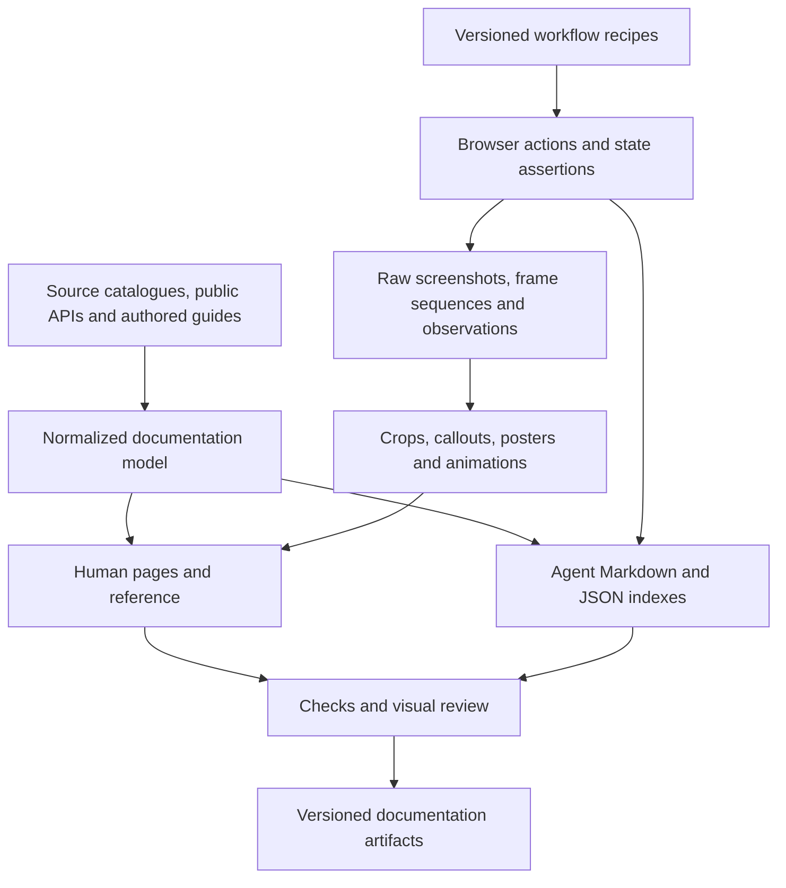

# Human and agent documentation across 0SFS, FOSS Earth and UMN-VR

Draft plan, 2026-10-21. Scope: all three projects from the beginning. This is a
proposal for implementation; commands, directories and output formats marked
as proposed below do not exist yet.

Build one documentation system with two reading experiences: visual,
task-oriented guides for people, and concise, structured navigation and
reference for agents. Both should draw facts from the same application
catalogues, public APIs, source metadata and executable workflows. Keep the
explanations and editorial decisions authored and reviewed.

The first milestone should demonstrate the complete system on one useful
workflow in each project. Expand after regeneration, review and publishing
work for those three examples.

## 1. Existing foundations and gaps

The local checkouts already provide much of the foundation:

| Existing source | Use in the proposed system |
| --- | --- |
| Organization `.github/AGENTS.md` and `agent-reference.md` in all three organizations | Preserve the short entry points and task-specific guidance; generate inventories beneath them |
| In-progress Earth docs `docs/agent-start.md`, `docs/agent-testing.md`, `docs/test-feedback.md` and `scripts/agent-context.mjs` | Integrate the new task routing, device-testing/feedback guidance and lightweight context discovery instead of duplicating them |
| `foss-earth/browser-testing/scripts/shots.mjs` and its screenshot review report | Reuse cropped screenshots, readiness conditions, touch steps and changed-image review |
| `0sfs/fly/build/shots/index.html` | Existing example of the visual review experience; ignored review output, not a public documentation asset store |
| `foss-earth/ui/src/settings/registry.ts` and the Earth settings catalogue | Extract settings IDs, labels, descriptions, choices and contextual defaults |
| `0sfs/aircraft/src/aircraftCatalog.ts` | Generate aircraft reference, thumbnails, variants and model credits |
| Package manifests, public exports, installers and build-input records | Generate command reference, package/ownership maps and exact source provenance |
| `foss-earth/docs/scripts/check-links.mjs` | Extend existing link validation rather than introducing an unrelated checker |
| `UMN-VR/tour/docs/`, campus scene repositories and the tour README | Seed user guides, route/stop reference and content-authoring procedures |

Treat proposals, historical migration notes, current runtime behaviour and test
evidence as different kinds of material. Inventory them before moving pages.
Existing campus browser fixtures describe pending integration qualification;
their presence is not proof that the full application currently passes.

The checkout also contains in-progress agent navigation, testing and feedback
documents plus a context-discovery script. Integrate these sources and verify
their eventual published versions before adoption. Audit all agent entry links
and release availability during the inventory; local file presence alone does
not establish that a published task route works.

## 2. Content ownership and publishing layout

Keep sources with the repository responsible for their meaning. Share the
build and capture machinery across projects.

| Owner | Content and responsibility |
| --- | --- |
| `foss-earth/docs` | Shared architecture, cross-project navigation, documentation schemas, generation orchestration and the initial shared docs tooling |
| `foss-earth/browser-testing` | Generic browser lifecycle, screenshot capture and any reusable recording adapter; no flight or campus behaviour |
| Earth app and component repositories | Earth workflows, application fixtures, public API comments and component-specific explanations |
| `0sfs/docs` | Flight user/developer guides and flight-wide architecture |
| Flight component repositories | Aircraft/engine/feature reference sources, examples and workflow assertions |
| `UMN-VR/tour/docs` and relevant campus repositories | Tour guides, scene/content editing procedures, route facts and media attribution |
| `UMN-VR/UMN-VR.github.io` | Club-site instructions, if needed; keep its publishing instructions distinct from the tour's |
| Each organization's `.github` repository | Authored agent policies and contribution rules |
| Each application's website/release owner | Assemble and publish its documentation output with its own release |

Initially house generic documentation scripts in an explicitly scoped tooling
directory in `foss-earth/docs`. Expose a versioned development CLI or artifact
that other repositories can consume through public entry points. Keep the
lightweight source/link checks usable without installing the browser, media
or site toolchain. A dedicated tooling repository can follow if maintenance
needs justify it; the first milestone does not require creating one.

Present a separate human documentation home for each project, with consistent
navigation and links to shared concepts. Use `/docs/` under each relevant
site, with a distinct tour documentation route such as `/tour/docs/` where
needed. Confirm base paths and domain ownership before implementing routing.
The existing 0SFS site builder currently assembles the landing page and flight
outputs; copying the docs artifact into that assembly is proposed work.

A small shared developer/agent index should explain which project owns a
feature. People should reach guides from the app and repository README;
agents should reach source files without requiring a rendered website.

## 3. Human documentation structure and quality

Organize around what the reader wants to accomplish. Use tutorials, how-to
guides, reference and explanation as distinct page types, following the
[Diátaxis framework](https://diataxis.fr/).

| Area | Typical pages | Visual treatment |
| --- | --- | --- |
| Start here | First flight; explore the globe; take a campus tour | One clear outcome, initial screenshot, short step sequence and result |
| Common tasks | Change aircraft, connect a phone, change a map, open a panorama, reset a setting | Cropped screenshots or a short animation per meaningful interaction |
| Controls and reference | Keyboard/gamepad bindings, settings, aircraft, scene routes, URL options | Generated tables, labelled diagrams and relevant UI crops |
| Understand the system | Globe/panorama relationship, flight model, settings inheritance, performance choices | Source-generated diagrams and data-derived charts with authored explanation |
| Contribute | Set up a checkout, modify a component, add content, validate, prepare a release | Tested commands, repository map, terminal transcripts and workflow diagrams |
| Troubleshoot | Startup failure, missing imagery, device connection, wrong build, unavailable feature | Symptom → check → action → expected result, using actual captured error states |

Every procedural page should state its audience, prerequisites, starting
state, expected outcome and relevant device/browser limits. Keep steps short,
name controls exactly as the app does, and show the result of each significant
step. Include recovery where a workflow commonly fails. Explain a concept
before linking to exhaustive generated reference when necessary.

Suggested visual defaults: one useful overview image near a guide's beginning;
one focused visual for each step that is hard to locate or understand; an
animation when order, motion or a gesture matters. A setting's entire list of
values usually needs a table more than another screenshot. Let clarity decide
the number of visuals; do not optimize for an image count.

Keep a small authored story for every workflow. Do not infer a good tutorial
from a list of recorded clicks. Instructions should remain usable when images
do not load, and every animation should have an equivalent written sequence.

## 4. What to generate and what to author

| Material | Canonical source | Generated outputs | Editorial work |
| --- | --- | --- | --- |
| Settings | Registered parameter definitions and context evaluators | Human tables; agent JSON; per-setting anchors; selected UI crops | When to change a setting and consequences |
| Controls | Actual input/action registrations | Keyboard/gamepad/touch reference and diagrams | Device advice and task examples |
| Commands | `package.json`, CLI help and a small command-purpose manifest | Command tables, agent command index, checked examples | Purpose, prerequisites and side effects |
| API reference | Public exports, types and documentation comments | HTML reference; machine-readable API model | Contracts, examples and rationale |
| Aircraft/engines | Shipped catalogues and asset credit records | Feature/variant tables, thumbnails, cross-links | Selection advice and modelling limits |
| Campus/scene content | Scene metadata, routes and content credit records | Stop indexes, route maps, panorama contact sheets | Tour narrative and editing guidance |
| Architecture | Package dependencies plus authored relationship metadata | Dependency/ownership diagrams and agent repository index | Runtime flow, boundaries and design tradeoffs |
| Tutorials | Authored workflow metadata plus executable actions/assertions | Step images, captions, animation, observed-result data and page fragments | Learning sequence, wording and explanations |
| Troubleshooting | Stable error identifiers and reviewed remedies | Error index, linked UI states, checked reproduction scenarios | Diagnosis and recovery advice |
| Release changes | Reviewed change entries and release inputs | Versioned summaries and links | User impact and migration explanation |

Use TypeDoc as the initial candidate for TypeScript public API extraction. It
can process public entry points and merge separately generated JSON models;
verify the pinned version against the projects' TypeScript versions before
adoption. Keep internal implementation modules out of the default reference.
See [TypeDoc input options](https://typedoc.org/documents/Options.Input.html).

Prefer public, side-effect-free metadata exports. Some settings defaults and
bounds depend on device context or capabilities: publish the rule plus named
desktop/phone/context examples, rather than serializing a function or claiming
one value is universal. Instantiate runtime registries only inside controlled
fixtures where necessary. Document measured values separately from defaults.

Add metadata to the existing registration site when it is missing. Avoid a
second hand-maintained settings or command catalogue just for documentation.
Curated metadata is appropriate for meaning that code cannot express, such as
which reader a command serves or whether it publishes changes.

AI assistance can propose prose, alt text and missing descriptions. Treat
those as reviewable drafts. Deterministic extraction should produce factual
reference; merging an unverified prose rewrite on every code change should
not be part of the pipeline.

## 5. Shared source model and build contract

Use three small, versioned schemas: a document record, a workflow record and
an artifact manifest. Do not create a general-purpose content platform.

The document record identifies its stable ID, project, audience, page type,
source owner/path, status (`current`, `proposed`, `experimental`, `historical`),
input dependencies, workflow IDs and applicable release/capabilities. Derive
verification status from check results. Generating a page today does not mean
someone verified its advice today.

The workflow record contains:

- Stable ID and owning application; title, reader outcome and prerequisites.
- Starting route, named fixture, viewport/device, theme, locale and capability context.
- Numbered human instructions mapped to real browser actions and named checkpoints.
- A readiness condition and a state assertion for each important checkpoint.
- Capture crop, highlights/callouts, meaningful hold durations and output formats.
- Plain-text captions, alt-text descriptions and expected outcomes.
- Dependencies on packages, settings, assets and authored pages.

Keep executable workflow code beside the owning app or component. Reference
it by a public adapter/CLI, not by importing application internals into the
generic tool. Share actions between docs and browser checks where useful, but
retain assertions that independently establish the expected result.

The artifact manifest records all source repository commits and content pins,
fixture/recipe/generator versions, browser and graphics backend, viewport,
capability context, artifact hashes, captions and assertions/check results.
Record original capture and last verification separately from site build time.

For local drafts, identify dirty inputs and hash their content. For published
release docs, require an immutable, coherent set of accepted source inputs.
Do not fetch the newest branch from every repository at build time and call
the combination a release. Reuse the existing build-input conventions where
possible; a docs source set may need more repositories than the app's own record.

Conceptual pipeline:



## 6. Scripted image and animation production

Use the existing screenshot runner first. Promote durable capture recipes
into version-controlled workflow directories; keep raw captures, profiles,
logs and comparison reports under each owner's ignored `build/`. The current
runner already supports cropping, touch actions and condition-based waits;
it does not by itself provide the proposed animation pipeline. See its
[capture contract](https://github.com/foss-earth/browser-testing/blob/main/docs/screenshots.md).

For each recipe, the capture pipeline should:

1. Open a fresh, isolated browser profile with explicit fixture data and storage.
2. Wait for the application's actual ready/input state and required assets.
3. Perform the user action, then assert the resulting application state.
4. Capture an overview and focused checkpoint images, plus a frame sequence
   when the transition or gesture is relevant.
5. Render numbered callouts, arrows and pointer trails from measured element
   bounds. Keep the pristine source capture alongside the annotated derivative.
6. Encode a poster, responsive stills, short GIF and site video where useful.
7. Produce captions, provenance and a comparison gallery for review.

Callouts must use resolved element bounds rather than hard-coded screen
coordinates. Fail when a target is missing, ambiguous, clipped or detached.
Use stable accessible names or explicit test identifiers for actions and
capture anchors. Test identifiers should not become visible instructions.

Two recording modes are useful. A checkpoint animation can hold a few verified
screenshots for a deliberate duration and is cheap to regenerate. A genuine
motion demo records the actual interaction or deterministic simulation frames;
use it for camera motion, gestures and control response. Do not portray a
slideshow as evidence of a smooth animation.

Extend the shared browser adapter only where needed. If continuous recording
is missing, evaluate a focused Playwright adapter before building a recorder
from scratch. Playwright provides [video recording](https://playwright.dev/docs/videos)
and [browser clock control](https://playwright.dev/docs/clock); clock control
alone does not make native workers, physics, XR hardware or GPU output deterministic.

Use FFmpeg for trimming, frame timing, scaling and encoding. Generate GIF
palettes with `palettegen`/`paletteuse` when appropriate; make the encoding
recipe explicit and versioned. See the [FFmpeg filter documentation](https://ffmpeg.org/ffmpeg-filters.html#palettegen).
Use an SVG/Node rendering step for labels and diagrams instead of painting
annotations by hand. Generate charts directly from retained numeric data,
with units, environment and measurement date.

### Capture reproducibility

Pin browser/tool versions, fonts, locale, timezone, viewport, device scale,
theme, seeded data and storage. Hide live counters and unrelated animation in
UI crops. Wait for fonts, decoded images, required tiles and application state
instead of sleeping for guessed durations. Bound every wait and retain a useful
failure capture. Do not retry until an unstable result happens to match.

Pause or explicitly step camera/simulation state for stills. Time-based demos
need a controlled timeline. Do not stop the motion a guide is explaining.
Use small redistributable fixtures for normal CI; capture live scenery in a
separate controlled run and retain provider attribution. A screenshot of a
fixture validates that fixture's UI, while an integration capture establishes
the application behaviour it actually exercises.

Require repeatability within a pinned capture environment. GPU screenshots
need not be byte-identical across machines; compare appropriate crops and
tolerances, and review meaningful changes. No headless capture establishes
real-headset comfort, phone connectivity, GPU performance or hardware support.
Mark hardware-dependent claims with the device/browser actually verified.

### Formats and presentation

| Need | Output policy |
| --- | --- |
| Precise UI detail | PNG master; optimized WebP or PNG derivative after checking legibility |
| Diagram or input map | Generated SVG with text/table equivalent; raster fallback where needed |
| Short GitHub demonstration | Small, focused GIF plus written steps; finite playback or poster link when motion cannot be controlled |
| Documentation-site animation | Poster with user-controlled MP4/WebM playback, captions and a replay action |
| Longer explanation | Chaptered video with transcript, retained source recipe and still-image steps |

Start with roughly 4–12 seconds for focused demonstrations and tune by reading
time. Prefer one action per clip. Keep labels legible at narrow widths, reserve
image dimensions to avoid layout shifts, lazy-load below-the-fold media and
load video data on demand. Set measured per-file/page budgets after the pilots;
suggested starting ceilings are 300 KB per ordinary screenshot, 2 MB per short
site demo and 3 MB per GIF, with reviewed exceptions for necessary detail.

Provide a static presentation for reduced-motion users and keyboard-accessible
playback controls. Avoid multiple auto-playing loops. Automatically starting
motion lasting more than five seconds alongside other content requires a
pause, stop or hide mechanism under the relevant WCAG criterion; looping a
short GIF can exceed that duration. See [W3C's guidance](https://www.w3.org/WAI/WCAG22/Understanding/pause-stop-hide.html).

Campus photographs and external map/model assets keep their own credits and
distribution terms. Verify what can enter a public docs artifact; the project
code license does not grant rights to every captured image. Use approved
sample assets and isolated accounts/data so screenshots do not capture keys,
real connection codes or personal browser state.

## 7. Agent documentation experience

Keep `AGENTS.md` an authored policy entry point: essential repository rules,
task routing and links. Preserve its existing requirements. Generate adjacent
reference files; do not let an extractor silently rewrite contribution policy.
Retain the shared `docs/agent-start.md` routing page and
`docs/agent-testing.md` procedures, and extend `scripts/agent-context.mjs`
where appropriate rather than replacing their discovery workflow.

Proposed outputs per project:

```text
AGENTS.md                         authored policy and task index
docs/agents/index.md               compact task/owner navigation
docs/agents/repositories.json      repository ownership and public boundaries
docs/agents/commands.json          commands, working directories and effects
docs/agents/settings.json          parameter IDs, rules and source references
docs/agents/workflows/*.md         prerequisites, actions, expected state, checks
docs/agents/verification.json      source set and actual verification results
```

Adapt these paths to existing owner layouts rather than moving everything to
match the example. Keep generated files small and split large catalogues by
feature. Markdown should carry important explanations; JSON should carry
schema-versioned facts. Provide stable IDs and source links pinned to the
documented revision. Images supplement the text and are never the only place
an agent can find a command, expected result or ownership boundary.

A task entry should answer: which repository owns this, which files/exports
matter, what must be read first, how to reproduce it, which command verifies
it, what result is expected, and what remains unverified. Record command
working directory, prerequisites, output locations, approximate cost when
measured, and side effects such as deployment or data deletion. Listing a
command never grants permission to execute it.

Link to shared concepts instead of copying them into three manuals. Keep
short project-specific overlays for flight, globe and campus behaviour.
Exclude historical/proposed material from the default current-task index;
retain it with explicit status and search filters. Optionally emit a small
`llms.txt` navigation file from the same index if a consumer benefits; it is
an extra discovery format, not a replacement for repository instructions.

## 8. Documentation site and artifact storage

Use VitePress as the initial site-generator candidate: Markdown sources,
static HTML output and a default documentation theme fit the existing
Node/TypeScript toolchain. Pin a stable release during implementation; do not
adopt a prerelease just because the documentation site defaults to it.
Its [site overview](https://vitepress.dev/guide/what-is-vitepress) and
[local search support](https://vitepress.dev/reference/default-theme-search)
cover the relevant baseline. Validate one real page with media, source links
and deployment base paths before committing the whole documentation tree.

Build three project outputs using shared theme/configuration and source
records. Each site should provide project identity, task navigation, local
search, current-release identification, source/edit links and a direct Markdown
link. Filter search by audience/status and avoid indexing archives by default.
Plain Markdown and JSON should remain usable without the site toolchain.

Keep small approved posters/screenshots in versioned media directories or
immutable media artifacts. Store large videos and frame archives in release
or artifact storage, with content hashes and a retention policy. CI artifacts
are useful for previews but their expiring URLs must not become permanent docs
links. Decide permanent public media hosting during the pilot before publishing.

Generated documentation should have one convention: an editable source and a
clearly marked generated output. CI should compare regenerated output with
committed files when those files are tracked, or verify a complete build when
outputs are artifact-only. Do not commit raw frames, temporary profiles, caches
or visual-diff archives. Use deterministic ordering and avoid changing every
page merely to print the current build timestamp.

## 9. CI, freshness and review

Proposed command interface, implemented through one shared CLI with project
profiles. The names below describe the desired contract, not current npm scripts:

```sh
npm run docs:extract                  # catalogues, public APIs, source metadata
npm run docs:capture -- --workflow ID # selected workflow images/frames
npm run docs:media                    # derivatives from retained captures
npm run docs:generate                 # human fragments and agent reference
npm run docs:check                    # schemas, links, freshness, examples, budgets
npm run docs:build                    # project site and downloadable docs bundle
npm run docs:preview                  # local review, with an explicitly started server
```

Default pull-request checks should be lightweight: validate schemas and local
links/anchors, regenerate changed reference, compile safe examples, check media
references/alt text and build affected pages. Extend the existing checker with
anchor/site-output coverage; its current report explicitly excludes network
and anchor qualification. Cache source extraction and media by their complete
input fingerprint, including shared CSS, fonts, fixtures, browser and generator.

Track a dependency graph from source files/packages to catalogue entries,
workflows and pages. An extractor or shared UI change should invalidate all
affected project outputs. Conservatively widen regeneration when dependencies
are uncertain. An unchanged filename does not prove an image is fresh.

Run a small affected-workflow capture job when relevant UI changes. Put the
larger visual matrix, live integrations and GPU/device runs in scheduled or
explicit release jobs with bounded duration and suitable hardware. Observe
the existing laptop/CPU limits; the routine local command should not start
three heavyweight application builds and browsers together.

Give reviewers: affected guides, changed facts, old/new media and diff views,
assertion results, source provenance, broken links, stale dependencies and
remaining hardware checks. Reuse the screenshot review gallery. A changed
baseline requires inspection and a reason; never auto-accept it solely to
turn CI green.

Published docs should name the app release/source set they describe. Require
current captures for changed documented workflows, and report unaffected older
captures as verified against their actual inputs. Preserve stable URLs and
redirects when moving guides. Schedule external-link checks separately from
offline checks to avoid making every small edit depend on external uptime.

Compile/run only examples explicitly marked as safe verification examples;
do not execute every shell block in the docs. Deploy/publish commands must
stay outside automatic example execution. Publishing a docs site follows
the existing repository's release authorization and workflow.

## 10. First deliverable: three complete pilot workflows

| Project | First workflow | Outputs and checks |
| --- | --- | --- |
| 0SFS | Open the aircraft picker, select another aircraft and confirm it became active | Cropped picker/selected-state images, short demo, generated aircraft reference, actual activation assertion and agent reproduction/check guide |
| FOSS Earth | Open a known scene, navigate it, change one setting and restore its default | Overview plus setting crop, gesture/setting demo, generated setting entry, effective-state assertion and task/owner links |
| UMN-VR | Choose a campus, open a known panorama, follow a link to another stop and return | Selector/stop images, short navigation demo, generated route/stop facts, destination/return assertions and content-owner guidance |

Use real current behaviour when selecting the exact controls. Start with one
desktop presentation for each workflow and one meaningful touch presentation
per project. Include an actual compact viewport, not just a desktop screenshot
scaled down. Use approved fixture imagery for repeatability; separately
identify any live or device verification.

Follow the pilots with a shared headset workflow: enter emulated VR, open a
panel, interact with a control and reposition the panel. The in-progress
`docs/agent-testing.md` describes the development headset adapter; verify its
current application contracts before recording. Produce an orientation view
and readable panel crops, and label the result as emulation. Keep actual
headset legibility, input behaviour and comfort as separate device checks.

For every pilot, acceptance means an authored human guide, static images, one
appropriate animation, equivalent text, agent task instructions, structured
facts, provenance and a runnable regeneration command. Deliberately change
one underlying label/value in an isolated fixture to demonstrate that freshness
checks detect it and that the intended outputs update.

## 11. Implementation sequence

| Stage | Work across all three projects | Exit condition |
| --- | --- | --- |
| 0 — Inventory and sources | Classify current docs; identify owners/versions; audit entry links; pick the three pilot workflows and approved assets | Source/status inventory, correct task routes and agreed pilot outcomes |
| 1 — Shared contract | Define the three schemas, project profiles, fixture lifecycle and generated-output conventions; extract one catalogue slice per project | Valid normalized data with source pins and no duplicated runtime facts |
| 2 — Vertical pilots | Capture/assert all three workflows; generate stills, callouts, GIF/site video, human pages and agent records | A complete preview bundle for each project that another person can regenerate |
| 3 — Checks and release integration | Implement affected-dependency invalidation, review gallery, lightweight CI, permanent media references and site assembly | A changed source causes the right docs to be checked; release docs identify their app inputs |
| 4 — Priority coverage | Add top user tasks, setup/troubleshooting, public APIs, settings and controls; migrate current useful pages with redirects | Essential tasks documented and reference coverage measured for every project |
| 5 — Ongoing maintenance | Add docs requirements to feature work, periodic capture/link jobs and real-device review; archive superseded pages | Documentation updates travel with feature changes and known gaps stay visible |

Each stage has deliverables in all three projects. Shared tooling does not
require feature parity: campus routes and aircraft activation can use different
assertions through the same workflow/artifact contract. Complete the three
pilots before attempting to screenshot every panel or migrate every archive.

Break implementation into reviewable changes: (1) schema/source inventory,
(2) extractors, (3) capture/encoding integration, (4) one pilot bundle per
project, (5) freshness checks, and (6) site/release assembly. Coordinate shared
tool changes with each application owner. A calendar estimate should follow
the pilots, because asset availability and deterministic runtime control are
the largest unknowns.

## 12. Measures of success and immediate next work

Measure generated reference coverage against known registries, public exports
and command inventories. Measure workflow coverage against a curated list of
important tasks, not against raw page count. Track stale captures, broken
links, capture failure/flakiness, regeneration time and published media size.
Report automated reference coverage separately from authored guide coverage.

Ask a new reader to complete the pilot task using only the guide; record where
they get stuck and whether the expected outcome occurs. Evaluate agent docs
with a small fixed task set: find the owner, reproduce a behaviour, choose the
right verification command and distinguish verified current behaviour from a
proposal. Measure correctness and required reading, not just token reduction.

The first implementation change should establish the source inventory,
workflow/document/artifact schemas and three project profiles. Then implement
the smallest end-to-end pilot bundle for each project. That provides a concrete
basis for choosing media budgets, permanent hosting and the amount of prose
that can usefully be generated.
