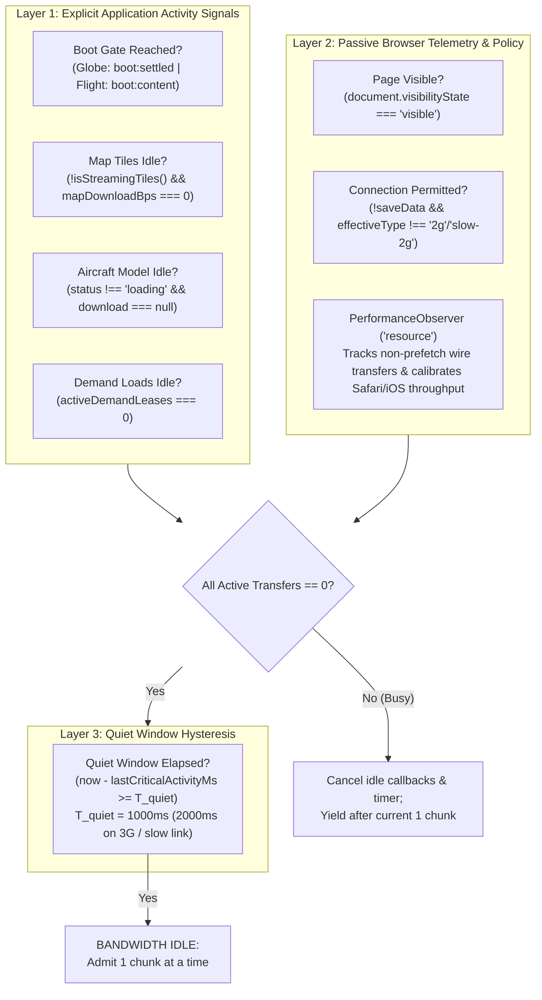
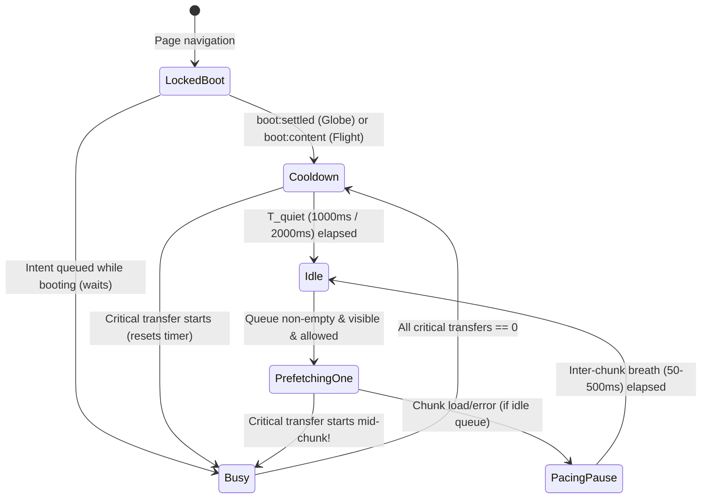

# Specification: Bandwidth-Gated JIT Code Download and Prefetch System

Status: specification, 22 October 2026. Applies to FOSS Earth (`foss-earth/app`), the UMN Campus Tour (`UMN-VR/tour`), and 0SFS (`0sfs/fly`, `0sfs/rc`, `0sfs/multiplayer`, `0sfs/anti-cheat`).

---

## 1. Objective and Core Invariants

The JIT code-download system optimizes two metrics simultaneously without allowing the second to degrade the first:

1. **Minimum time to a usable first frame** (`boot:first-frame`, `boot:globe`, `boot:content`): Every byte of JavaScript, CSS, or data that is not required to render the initial view and primary subject (the globe or the aircraft in flight) is excluded from the startup module graph and loaded via dynamic `import()`.
2. **Minimum time until the next opened feature is ready** ($T_{\text{open}} \to 0\text{ ms}$): While the user is looking at or flying in the scene, the browser fetches and compiles the modules of features they are about to open (`intent`) or may open later (`idle`) into the browser's ES Module Map using spare network capacity.

### Four Non-Negotiable Invariants

1. **Zero Contention with Critical Transfers:** Background fetches (`idle` feature preloads and `warmPages` cross-page prefetches) may use **only** bandwidth the page is not already using. Any background fetch that competes with `boot:first-frame`, with terrain or imagery tiles, with WASM initialization, or with an aircraft glTF/texture load is a failed design.
2. **CPU Idle $\neq$ Network Idle:** `requestIdleCallback` indicates main-thread frame slack, which frequently peaks *while* the network is 100% saturated waiting on tile or glTF I/O. Network availability is governed by an explicit **Bandwidth Coordinator**, never by `requestIdleCallback` alone.
3. **Fetch and Compile Without Execution or Side Effects:** Prefetching injects `<link rel="modulepreload">` for JS chunks and `<link rel="preload" as="style">` for CSS chunks. It **never** calls `import()` and **never** attaches `<link rel="stylesheet">`. Top-level module code does not run, CSSOM does not recalculate styles, and the render-on-demand loop is never woken by a prefetch.
4. **"Off Until the Pilot Asks" Remains Absolute:** Prefetching a dormant opt-in feature (such as `@0sfs/multiplayer` and `@0sfs/anti-cheat` when `osfs.multiplayer` is `false`) populates only the browser's module map. It never enables the setting, instantiates a session, opens a WebSocket/WebRTC peer connection, or starts an anti-cheat watcher.

---

## 2. Audit of Existing Behavior and Exact File Changes

| File | Current Behavior | Defect / Limitation | Specified Change |
| :--- | :--- | :--- | :--- |
| `docs/docs/proposals/startup-loading.md` (FOSS Earth) | Section 1 defines `defineLazyFeature` (`intent`, `idle`, `never`) and starts the `idle` queue at `boot:settled` (1,000 ms of stopped frames after `boot:first-frame`). | 0sfs `/fly/` runs a continuous 60 Hz physics/render loop and **never reaches `boot:settled`**. Also, after `boot:settled` on the globe, later camera pans stream new tiles without pausing the `idle` queue. | Replace the one-shot `boot:settled` gate with a continuous **Host Readiness + Bandwidth Idle** rule: globe starts after `boot:settled`, flight starts after `boot:content`, and both pause/resume dynamically whenever tiles or models stream. |
| `app/src/app/bootMarks.ts` | `markBootSettled` waits for `SETTLED_QUIET_MS = 1000` of zero rendering after `boot:first-frame`. | Coupled to render-on-demand frame cessation; unusable for continuous simulation loops. | Keep `markBootSettled` for render-on-demand benchmarks; use `boot:content` + `BandwidthCoordinator` readiness for continuous hosts. |
| `app/src/app/lazyFeature.ts` | Pumps 1 `<link rel="modulepreload">` at a time; checks `visibilityState`, `saveData`, and `2g`/`slow-2g`; schedules `idle` items via `requestIdleCallback`. | 1. No check for in-flight tiles, aircraft, WASM, or demand loads.<br>2. **Promotion Bug (L111)**: Once `startIdle()` adds an `idle` feature's URLs to `requested`, hovering its tab (`queue(true)`) filters them out via `!requested.has(url)` instead of promoting them to the front of `pending`.<br>3. Missing `fetchpriority="low"` on `idle` preloads.<br>4. Immediate `pointerover` fires downloads during fast mouse sweeps across tabs.<br>5. Lives in `foss-earth/app`, unshared with `0sfs`. | Move runtime to `@foss-earth/ui/browser` (re-exported by `foss-earth/shell`). Integrate `BandwidthCoordinator`, fix `pending` promotion, set `fetchpriority`, add 40 ms hover micro-dwell, support CSS prewarming, and cancel in-flight idle callbacks on network busy. |
| `app/src/app/lazyFeature.test.ts` | Tests memoized `load()`, 1-at-a-time preload, `startIdle()`, `watchTabIntent()`, `hidden`, and `saveData`/`2g`. | Does not test bandwidth yielding, quiet-window hysteresis, idle-to-intent promotion after `startIdle()`, demand preemption, or missing `navigator.connection` on Safari/iOS. | Expand suite in `@foss-earth/ui` to cover the full state machine and edge cases. |
| `app/src/app/lazyFeatureChunks.ts` | Defines `LAZY_FEATURES_ELEMENT_ID` and `{ urls: string[], bytes: number }`. | Does not distinguish JS module chunks from CSS assets (`viteMetadata.importedCss`). | Move to `@foss-earth/ui/browser`; add optional `styles?: string[]` while preserving backwards compatibility. |
| `app/vite/lazyFeatures.ts` | Scans for literal `defineLazyFeature({ id: "…", load: () => import("…") })` and emits `<script id="foss-earth-lazy-features">`. | 1. `reach(bundle, entry, false)` (L55) only excludes static imports of `entry` (`main.tsx`), ignoring `waitFor` (`createFlightSimApp.ts` in `/fly/`).<br>2. Emits BFS root-first chunk order instead of post-order dependency-first.<br>3. Ignores `importedCss`. | Move implementation to `@foss-earth/ui/vite` (re-export from `foss-earth/vite`), accept `{ waitFor?: string[], pages?: (path: string) => boolean }`, emit post-order dependency-first `urls`, and collect `styles`. |
| `ui/vite/index.mjs` (`warmPages`) | Injects `<script type="speculationrules">` (`eagerness: "moderate"`) and after `load` + `requestIdleCallback` prefetches next pages' files with `WARM_AT_ONCE = 4`. | `WARM_AT_ONCE = 4` seizes 4 of 6 HTTP/1.1 sockets and bloats cellular HTTP/2 buffers, delaying every file by 4× and competing with on-page assets. | Change `WARM_AT_ONCE` from `4` to `1`, add `fetchpriority="low"`, and gate each file on the shared bandwidth quiet rule. |
| `app/src/app/createGlobeApp.ts` | Calls `markBootSettled(..., startIdlePrefetch)` and `watchTabIntent(document)`. | Does not pass live tile streaming (`runtime.isStreamingTiles`, `runtime.onTilesStreamingChange`, `runtime.onMapDownloadRateChange`) to the prefetcher. | Connect `runtime` tile streaming and download rate signals to the shared `BandwidthCoordinator`. |
| `0sfs/fly/vite.config.ts` & `pages-html.mjs` | Uses `bootTerminal({ waitFor: ['src/flight/createFlightSimApp.ts'] })`; does not use `lazyFeatures()`. | Flight bundle has no `<script id="foss-earth-lazy-features">` chunk map. `/rc/` copies `/index.html`. | Add `lazyFeatures({ waitFor: ['src/flight/createFlightSimApp.ts'], pages: page => page === '/index.html' })` to `fly/vite.config.ts` and strip the lazy-features script tag when retagging `/rc/` in `pages-html.mjs`. |
| `0sfs/fly/src/flight/createFlightSimApp.ts` | Statically imports `mountBindingEditor` (L62); loads phone pairing via raw `Promise.all([import(...), import(...)])` (L2455); never starts idle/intent prefetch. | Controller bindings editor (16.5 KB) sits on the flight startup graph; phone pairing (151 KB raw / 47 KB gzip) is not prefetched on `remote` tab intent; flight download signals are not wired to prefetch. | Convert `gamepad-editor`, `phone-pairing`, and `multiplayer` to `defineLazyFeature`; wire `boot:content`, `runtime.isStreamingTiles`, `runtime.onMapDownloadRateChange`, and `aircraftModel` `onStateChange` into the coordinator. |
| `0sfs/multiplayer/src/availability.ts` & `multiplayer.md` | `createMultiplayerAvailability` has its own `idlePrefetchAllowed` and calls `request()` $\to$ `load()` (`import("./sessionWorld")`) inside `prefetchIfIdle()`. | Calling `import()` in `prefetchIfIdle()` executes module top-level code during idle prefetch! Also separates anti-cheat from the multiplayer fetch unless bundled together. | `prefetchIfIdle()` calls a non-executing `prefetch()` hook (`<link rel="modulepreload">`), **never** `load()`. `enable()` remains an immediate demand `load()`. Client anti-cheat (`@0sfs/anti-cheat`) is statically imported inside the lazy multiplayer entry so both arrive in one lazy feature without touching the startup graph. |

---

## 3. Decision 1: What "Idle Bandwidth" Means in a Browser

### 3.1 Browser Platform Reality Matrix

| Mechanism | Chromium (Desktop & Android) | Safari / WebKit (macOS, iOS, iPadOS, visionOS) | Firefox (Desktop & Android) | Spec Consequence |
| :--- | :--- | :--- | :--- | :--- |
| `navigator.connection` (`saveData`, `effectiveType`, `downlink`, `rtt`) | Supported (`NetworkInformation` API + `"change"` event). | **Absent (`undefined`)**. All iOS browsers use WebKit and expose nothing here. | **Absent (`undefined`)** by default. | Missing `navigator.connection` is **not** permission to prefetch aggressively, and **not** a reason to prefetch nothing. |
| `<link rel="modulepreload" fetchpriority="low">` | Supported (Chrome 101+). Without `fetchpriority="low"`, defaults to `ResourceLoadPriority::kHigh`! | Supported (Safari 17.2+). | Supported (Firefox 132+). | Required on all `idle` preloads so they do not enter the browser's `kHigh` queue ahead of `fetch()` tile requests. |
| `PerformanceObserver` (`type: "resource"`) | Supported (`transferSize`, `encodedBodySize`, `requestStart`, `responseStart`, `responseEnd`). | Supported (Safari 11+ / iOS 11+). | Supported. | Universal passive sensor for completed wire transfers, RTT, and effective throughput across all browsers, including iOS. |
| In-flight request count API | **None.** Resource Timing only emits *after* `responseEnd`. | **None.** | **None.** | The application must track its own in-flight critical transfers explicitly via leases and reactive state hooks. |

### 3.2 Why `fetchpriority="low"` Alone Is Insufficient

Setting `fetchpriority="low"` on `<link rel="modulepreload">` or `<link rel="prefetch">` is necessary (because Chromium otherwise assigns `High` priority to `modulepreload`, equal to blocking scripts and higher than `fetch()` for terrain tiles), but **cannot** prevent contention by itself:

1. **HTTP/1.1 Socket Exhaustion:** Local preview/dev servers and some proxies use HTTP/1.1, which caps concurrent connections at 6 per origin. Once a low-priority request is dispatched onto a TCP socket, that socket is occupied until the response finishes.
2. **HTTP/2 & HTTP/3 Receive Window & Bufferbloat:** On cellular links (e.g., Fast 4G at $1{,}012{,}500\text{ B/s}$ down and $165\text{ ms}$ RTT, where the Bandwidth-Delay Product is $\text{BDP} \approx 167\text{ KB}$), once the server begins streaming a 100 KB background chunk over the shared TLS/TCP or QUIC connection, those frames are already queued in the carrier's middlebox and OS receive buffers. A terrain tile or aircraft glTF requested 20 ms later must wait behind the in-flight TCP segments on the radio link regardless of HTTP/2 stream weight.

Therefore, **application-level admission control** must prevent background chunks from being dispatched while the pipe is in use.

### 3.3 The Three-Layer Bandwidth Coordinator (`createBandwidthCoordinator`)

Bandwidth is defined as **Idle** if and only if all three layers below simultaneously report clear:



#### Layer 1: Explicit Application Activity Signals
The coordinator maintains a set of named boolean activity sources and reference-counted transfer leases:
- **`bootReady`**: `false` at navigation start. Transitions to `true` when:
  - On render-on-demand globe pages (`/app/`, `/tour/*`): `boot:settled` fires.
  - On continuous-rendering pages (`0sfs /fly/`): `boot:content` fires.
  - On non-scene pages (`0sfs /rc/`, tour selector): `markBrowserAppReady` / window `load` fires.
- **`tilesStreaming`**: Bound to `runtime.isStreamingTiles()` and updated via `runtime.onTilesStreamingChange(streaming)`.
- **`mapDownloading`**: Bound to `runtime.getMapDownloadBytesPerSecond() > 0` via `runtime.onMapDownloadRateChange(bps)`.
- **`aircraftDownloading`** (0sfs): Bound to `aircraftModel.getState()` via `onStateChange`: active whenever `state.status === "loading" || state.download !== null` (covers both initial aircraft load, user aircraft switches, and chase-distance `"auto"` LOD transitions).
- **`demandLeases`**: Incremented whenever any consumer calls `feature.load()` (demand import) or acquires a manual transfer lease (`coordinator.acquireTransfer(label)`), and decremented when the promise settles.

#### Layer 2: Passive `PerformanceObserver` & Safari/iOS Calibration
Because `navigator.connection` is `undefined` on Safari and iOS, and because sub-resources (such as glTF external buffers or worker WASM binaries) may finish transferring without holding an explicit lease, the coordinator attaches one passive `PerformanceObserver` for `type: "resource"`:

1. **Ignoring Self-Generated Prefetch Traffic:** The prefetcher records every URL it injects in a `prefetchedUrls: Set<string>`. When a `PerformanceResourceTiming` entry arrives whose normalized URL is in `prefetchedUrls`, it does **not** count as competing page traffic.
2. **Ignoring Local Cache Hits:** Entries with `transferSize === 0` came from the memory cache or Service Worker cache (`foss-earth-sw.js`) and consumed zero network bandwidth; they do **not** reset the quiet timer.
3. **Wire Activity Detection:** Any non-prefetch entry with `transferSize > 0` updates `lastActivityMs = Math.max(lastActivityMs, entry.responseEnd)`.
4. **Safari / iOS Passive Link Calibration:**
   On browsers where `navigator.connection` is `undefined`, the coordinator computes a rolling observation from the startup chunks (whose `transferSize` and duration `entry.responseEnd - entry.requestStart` are recorded during boot):
   $$\text{RTT}_{\text{obs}} = \text{median}(\text{responseStart} - \text{requestStart}), \quad B_{\text{eff}} = \frac{\sum \text{transferSize}}{\sum (\text{responseEnd} - \text{responseStart})}$$
   - If $\sum \text{transferSize} \ge 32{,}768\text{ B}$ and $B_{\text{eff}} < 50{,}000\text{ B/s}$ ($< 400\text{ kbps}$, matching 2G / severe cellular congestion), the coordinator sets `inferredSlow2G = true` for the current session (reset if a later demand transfer achieves $\ge 100{,}000\text{ B/s}$). While `inferredSlow2G` is true, `idle` background prefetches are suppressed just as on `effectiveType: "2g"`, protecting iOS users on throttled/roaming cellular data without requiring `navigator.connection`.
   - If $50{,}000\text{ B/s} \le B_{\text{eff}} < 180{,}000\text{ B/s}$ or $\text{RTT}_{\text{obs}} > 300\text{ ms}$ (or `navigator.connection?.effectiveType === "3g"`), the coordinator sets `congestedLink = true` and doubles the quiet window $T_{\text{quiet}}$ from $1000\text{ ms}$ to $2000\text{ ms}$.

#### Layer 3: Quiet Window Hysteresis ($T_{\text{quiet}}$)
Terrain streaming and 3D Tiles refinement proceed in parent-to-child waves: a parent tile finishes downloading, decodes in a worker ($20\text{--}120\text{ ms}$), and triggers child tile fetches on the next frame.
- Without a quiet window, a background prefetch would fire in the $50\text{ ms}$ gap between parent and child tile requests.
- The coordinator enforces a mandatory quiet period after the last critical transfer ends:
  - $T_{\text{quiet}} = 1000\text{ ms}$ on standard connections (`4g` or unknown with $B_{\text{eff}} \ge 180\text{ KB/s}$).
  - $T_{\text{quiet}} = 2000\text{ ms}$ on constrained connections (`3g` or $B_{\text{eff}} < 180\text{ KB/s}$ or $\text{RTT}_{\text{obs}} > 300\text{ ms}$).
- Only when all Layer 1 signals are false/zero **and** `now() - lastActivityMs >= T_quiet` does `coordinator.isIdleBandwidth()` become `true`.

---

## 4. Decision 2: How a Background Chunk Waits, Yields, and Resumes

### 4.1 Concurrency Is Strictly 1 Across All Background Queues

Both the module prefetcher (`lazyFeature.ts`) and the cross-page warmer (`warmPages` in `ui/vite/index.mjs`) enforce `MAX_CONCURRENT_BACKGROUND_FETCHES = 1`.

**Why `warmPages` must drop from `WARM_AT_ONCE = 4` to `1`:**
Suppose a page warms $N$ chunks of sizes $S_1 \ge S_2 \ge S_3 \ge S_4$ over a link of bandwidth $B$:
- Under `WARM_AT_ONCE = 4`, HTTP/2 multiplexes all 4 streams evenly, so each stream receives $B/4$. None of the 4 files finishes downloading until $t \approx 4 \cdot S_4 / B$, and the largest file $S_1$ takes $4 \cdot S_1 / B$ while holding 4 socket/stream slots open. If the visitor clicks a campus card at $t = 1.5\text{ s}$, all 4 prefetches are incomplete and contended.
- Under `WARM_AT_ONCE = 1`, file 1 receives the full idle bandwidth $B$ and commits to the HTTP cache at $t = S_1 / B$ (up to $4\times$ sooner), immediately freeing the connection before file 2 starts. If the visitor hovers or clicks a link, at most **one** file is in flight on the wire.

### 4.2 State Machine for Waiting, Yielding, and Resuming



1. **Waiting:** While in `LockedBoot`, `Busy`, `Cooldown`, `Hidden` (`document.visibilityState === "hidden"`), or `Vetoed` (`saveData` / `2g`), `pump()` dispatches nothing. No polling loop is used; wakeup is strictly event-driven via coordinator listeners, `visibilitychange`, and `navigator.connection` `change`.
2. **Yielding Within One Chunk Boundary:**
   - Features are broken into individual Rollup/Rolldown chunks (`urls: string[]`, `styles?: string[]`).
   - Because `busy` allows only **one** `<link>` element to be in flight at a time, if terrain streaming or an aircraft download begins while chunk $k$ is mid-flight:
     - The coordinator immediately cancels any scheduled `requestIdleCallback` (`cancelIdleCallback`) and any quiet/pacing timer (`clearTimeout`).
     - If the critical transfer that just started is `feature.load()` for the **same** feature, the in-flight `<link rel="modulepreload">` is not wasted: Vite's `__vitePreload` sees the `<link>` already in `document.head` (`i.all.has(s.href)`) and the browser's ES Module Map coalesces the `import()` onto the existing in-flight request!
     - If the critical transfer is unrelated (e.g., terrain tiles or aircraft glTF), chunk $k$ completes its remaining bytes, fires `done()`, sets `busy = false`, and `pump()` immediately exits because `!coordinator.isIdleBandwidth()`. Chunk $k+1$ is **not** requested.
3. **Adaptive Inter-Chunk Breath:**
   - For `idle` chunks (not `intent`), after chunk $k$ of byte size $S_k$ completes in duration $\Delta t_k$, the queue inserts a short **Inter-Chunk Breath** before scheduling chunk $k+1$:
     $$T_{\text{breath}} = \text{clamp}\!\left(\text{round}(0.25 \times \Delta t_k),\; 50\text{ ms},\; 500\text{ ms}\right)$$
   - This guarantees that background preloads never exceed $\le 80\%$ duty cycle on the link and always leave a $50\text{--}500\text{ ms}$ window between chunks for emerging terrain or user requests to claim the connection first.

---

## 5. Decision 3: Startup Phase Gating and the Continuous-Flight Rule

### 5.1 Phase Allowlist

| Lifecycle Phase | Start Mark $\to$ End Mark | Permitted Network Fetches | Forbidden Network Fetches |
| :--- | :--- | :--- | :--- |
| **Phase 0: First Frame Critical Path** | `boot:html` $\to$ `boot:first-frame` | • Document HTML, inline boot terminal, isolation worker (`foss-earth-sw.js`)<br>• Entry JS & static imports<br>• `bootTerminal` `waitFor` chunks (`/fly/`: `createFlightSimApp.ts`), **skipped if isolation reload is pending**<br>• Active renderer shader chunk (`babylon-shaders-wgsl` or `babylon-shaders-glsl`)<br>• Deferred shell overlay (`GlobeOverlay.tsx` + `react-dom`)<br>• Google 3D Tiles provider code **only** when starting on Google with a key | • All `idle` and `intent` lazy feature preloads<br>• All `warmPages` `<link rel="prefetch">`<br>• Inactive shader language chunk<br>• Non-selected map providers<br>• `@0sfs/multiplayer` and `@0sfs/anti-cheat`<br>• Closed tab editors (`gamepad-editor`, `pose-editor`, `phone-pairing`, `scene-thumbnails`) |
| **Phase 1: Content & World Population** | `boot:first-frame` $\to$ `boot:content` (and `boot:settled` on Globe) | • Opening view terrain & imagery tiles<br>• Sky/atmosphere & raster decode WASM workers<br>• **Flight (`/fly/`)**: Selected aircraft glTF & textures, JSBSim WASM & aircraft XML hydration, audio DSP WASM, F135 exhaust LUT<br>• Explicit user **Demand (`load()`)** if user clicks early<br>• **Intent (`prefetch: "intent"`)** *only* during brief moments when `!coordinator.isBusy()` | • **All `idle` feature preloads** (`startIdlePrefetch` is still locked)<br>• **All `warmPages` prefetches**<br>• Any `intent` preload while tiles or aircraft are actively transferring |
| **Phase 2: Steady Operation** | Post-`boot:settled` (Globe) or Post-`boot:content` (Flight) | • Demand loads (`load()`) immediately at any time<br>• Intent preloads when `!coordinator.isBusy()`<br>• Idle preloads & `warmPages` **only** when `coordinator.isIdleBandwidth()` is `true` (0 active transfers + $T_{\text{quiet}}$ elapsed) | • Any `idle` or `intent` preload while camera pan/zoom or flight path triggers tile streaming or aircraft LOD loading |

### 5.2 Why 0sfs `/fly/` Is a Separate Case and How It Starts Background Fetches

In `app/src/app/bootMarks.ts`, `markBootSettled` waits for `activity.isRendering()` to become `false` and stay `false` for `SETTLED_QUIET_MS = 1000`.
- On `/app/` and `/tour/minneapolis/`, the render-on-demand scheduler stops pumping frames once camera inertia decays and visible tiles finish streaming.
- On `0sfs /fly/`, `createFlightSimApp.ts` runs a continuous fixed-step physics loop and renders every animation frame. `runtime.isRendering()` is **permanently `true`**, so `boot:settled` **never fires**.

**The Flight Readiness Rule:**
In `0sfs /fly/`, the startup gate (`coordinator.markBootReady()`) is triggered not by `boot:settled`, but by the conjunction of:
1. `boot:content` has fired (`createFlightSimApp.ts:3424`, after JSBSim, initial terrain elevation, gear warmup, and the first rendered world frame with the loading screen hidden).
2. The initial aircraft mesh is ready (`aircraftModel.getState().status === "ready"` and `aircraftModel.getState().download === null`, or `"placeholder"` if no mesh exists).
3. Initial terrain tile streaming has completed (`!runtime.isStreamingTiles()` and `runtime.getMapDownloadBytesPerSecond() === 0`).
4. $T_{\text{quiet}}$ ($1000\text{ ms}$) of zero tile or asset downloads has elapsed.

As the aircraft flies and crosses tile boundaries, `runtime.onTilesStreamingChange(true)` and `runtime.onMapDownloadRateChange(bps)` fire whenever new terrain tiles stream in; the coordinator immediately transitions to `Busy`, pausing background prefetches until the burst finishes + $T_{\text{quiet}}$.

---

## 6. Decision 4: Priority Hierarchy and Creative Optimizations

### 6.1 The Four Priority Levels

| Priority | Name | Trigger | `saveData` / `2g` | Waits for Boot Gate? | Waits for Active Transfers = 0? | Waits for $T_{\text{quiet}}$ (1s)? | Waits for `requestIdleCallback`? | `<link>` `fetchpriority` | Executes Module (`import()`)? |
| :---: | :--- | :--- | :---: | :---: | :---: | :---: | :---: | :---: | :---: |
| **P0** | **Demand** | `feature.load()` / `availability.enable()` | **Allowed** (User asked) | **No** | **No** (Acquires demand lease; preempts queue) | **No** | **No** | `"high"` | **Yes** |
| **P1** | **Intent** | `watchTabIntent` (`[data-tab-id]`) or `feature.prefetch()` | **Skipped** | Wait until `boot:first-frame` | **Yes** (Queues at front; dispatches as soon as active = 0) | **No** (0 ms quiet wait) | **No** | `"high"` | **No** (`modulepreload` only) |
| **P2** | **Idle** | `startIdlePrefetch()` (`prefetch: "idle"`) | **Skipped** | **Yes** (`boot:settled` or `boot:content`) | **Yes** | **Yes** ($1000\text{--}2000\text{ ms}$) | **Yes** (`timeout: 5000`) | `"low"` | **No** (`modulepreload` only) |
| **P3** | **Never** | `prefetch: "never"` or `devOnly` without `?dev=1` | **Skipped** | N/A | N/A | N/A | N/A | N/A | Only when P0 `load()` is called |

### 6.2 Five High-Leverage Performance Optimizations

#### Optimization 1: Fixing the Idle-to-Intent Queue Promotion Bug
In today's `lazyFeature.ts:107-116`:
```ts
const fresh = urls.filter(url => !requested.has(url) && !preloaded.has(new URL(url, document.baseURI).href));
for (const url of fresh) requested.add(url);
```
When `startIdle()` runs, all `idle` features' URLs are added to `requested` and pushed to `pending` with `urgent: false`. If the user then hovers a tab belonging to a later `idle` feature, `queue(true)` sees those URLs already in `requested` and does **nothing**—leaving the hovered tab's chunks stuck at the back of the `idle` queue!
- **Fix:** `enqueue(items, urgent)` checks if any target URL is already sitting in `pending` with `urgent: false`. When `urgent === true`, those entries are extracted from their current positions in `pending`, upgraded to `urgent: true` (`fetchPriority: "high"`), unshifted to the very front of `pending` in their feature's dependency order, any pending `requestIdleCallback` wait is bypassed, and `pump()` is invoked immediately.

#### Optimization 2: 40 ms Hover Micro-Dwell for Pointer Intent (Zero False Positives)
When a user moves a mouse cursor across the toolbar from left to right to reach a button on the far right, `pointerover` fires on every intermediate `[data-tab-id]` button for $8\text{--}25\text{ ms}$ each.
- Today, the very first intermediate button brushed by the cursor immediately starts a network download (`busy = true`), blocking the actual target button's preload until that unwanted chunk finishes!
- **Fix in `watchTabIntent`:**
  - `focusin` (keyboard Tab navigation) and `pointerdown` (touch tap or mouse press): **0 ms delay** (immediate intent).
  - `pointerover` (mouse/pen hover): Arm a **40 ms timer** keyed to that `[data-tab-id]` element, and cancel it on `pointerout` / `pointercancel`.
  - A cursor sweeping across tabs spends $< 25\text{ ms}$ per tab (cancelled with 0 bytes fetched); a user stopping to click a tab hovers for $120\text{--}350\text{ ms}$ before `click` fires, so the preload still gets a $80\text{--}310\text{ ms}$ head start with zero wasted bandwidth.

#### Optimization 3: Post-Order (Dependency-First) Chunk Preloading
In `app/vite/lazyFeatures.ts:41-51`, `reach(bundle, home.fileName, false)` uses breadth-first traversal starting from the feature's facade chunk `[facade.js, sharedDepA.js, leafDepB.js]`.
- When `<link rel="modulepreload" href="facade.js">` is parsed by the browser, the browser discovers static `import` statements inside `facade.js` pointing to `sharedDepA.js` and `leafDepB.js`. In Chromium and WebKit, preloading `facade.js` before its dependencies can either stall module map instantiation or cause the browser's internal module tree fetcher to issue unthrottled parallel fetches for `sharedDepA.js` and `leafDepB.js`!
- **Fix in `lazyFeatures()`:** Emit `urls` in **post-order (topological leaf-first)** order: `[leafDepB.js, sharedDepA.js, facade.js]`.
  - Each leaf module has all of its dependencies already present in the ES Module Map at the moment it is preloaded!
  - The browser never triggers unthrottled child fetches behind the queue's back.

#### Optimization 4: Side-Effect-Free CSS Prewarming (`<link rel="preload" as="style">`)
Several lazy features import CSS (e.g., `createPhonePairingPanel.css`, `gamepad-tools` styles). When `import()` runs, Vite's `__vitePreload` blocks the `import()` promise until `<link rel="stylesheet">` finishes downloading over the network!
- We **cannot** inject `<link rel="stylesheet">` during prefetch because that immediately applies rules to the live document and triggers a synchronous style/layout recalculation.
- **Fix:** `lazyFeatures()` records `styles: string[]` from `chunk.viteMetadata?.importedCss` (excluding CSS already in the startup graph). During prefetch, the queue injects `<link rel="preload" as="style" crossorigin="" href="...">` (with `fetchpriority="low"` for idle). This warms the CSS bytes into the browser's preload/HTTP cache with **zero DOM style recalculation**. When `feature.load()` later runs, Vite's `__vitePreload` appends `<link rel="stylesheet">`, which resolves from the preload cache in $< 1\text{ ms}$!

#### Optimization 5: Demand Preemption & Queue Pruning
When `feature.load()` is called on demand:
1. It immediately strips all remaining queued items for `feature.id` from `pending` (so the background queue does not redundantly step through them later).
2. It acquires a demand lease on `BandwidthCoordinator`, immediately pausing background preloads of *other* features while Vite's `__vitePreload` fetches the demanded feature's remaining chunks at full browser concurrency.

---

## 7. Decision 5: Single Owner and Package Architecture

### 7.1 Owner: FOSS Earth (`@foss-earth/ui`)

**One rule, one implementation.** Having a queue in `foss-earth/app`, another inline loop in `@foss-earth/ui/vite` (`warmPages`), and a third gate in `@0sfs/multiplayer` (`createMultiplayerAvailability`) is prohibited.

**Ownership mapping:**

| Layer | Owner Package & Path | Exports | Consumers |
| :--- | :--- | :--- | :--- |
| **Runtime Queue & Bandwidth Coordinator** | `@foss-earth/ui/browser`<br>(`ui/src/browser/lazyFeature.ts`,<br>`ui/src/browser/bandwidthCoordinator.ts`) | `createBandwidthCoordinator`, `getPageBandwidthCoordinator`, `createLazyFeatures`, `defineLazyFeature`, `startIdlePrefetch`, `watchTabIntent`, `setLazyFeatureLog`, `LAZY_FEATURES_ELEMENT_ID`, `type LazyFeature`, `type LazyFeatureOptions`, `type LazyFeatureChunks`, `type BandwidthCoordinator` | • `foss-earth/app` (re-exports in `foss-earth/shell`)<br>• `UMN-VR/tour`<br>• `0sfs/fly` |
| **Vite Build Plugins** | `@foss-earth/ui/vite`<br>(`ui/vite/index.mjs` + `ui/vite/index.d.mts`) | `lazyFeatures(options?)`, `warmPages(options)` | • `foss-earth/app/vite.config.ts` (re-exports in `foss-earth/vite`)<br>• `UMN-VR/tour/vite.config.ts`<br>• `0sfs/fly/vite.config.ts` |
| **Feature Opt-In Gate (0sfs Multiplayer)** | `@0sfs/multiplayer/availability`<br>(`multiplayer/src/availability.ts`) | `createMultiplayerAvailability`, `MULTIPLAYER_PARAMETER_ID`, `idlePrefetchAllowed` | • `0sfs/fly` (wires `defineLazyFeature` into `createMultiplayerAvailability`) |

### 7.2 Exact TypeScript Contracts (`@foss-earth/ui/browser`)

```ts
// ui/src/browser/bandwidthCoordinator.ts

export interface ConnectionHint {
  saveData?: boolean;
  effectiveType?: string;
  downlink?: number;
  rtt?: number;
  addEventListener?(type: "change", listener: () => void): void;
  removeEventListener?(type: "change", listener: () => void): void;
}

export interface BandwidthCoordinatorPorts {
  now(): number;
  setTimeout(callback: () => void, ms: number): number;
  clearTimeout(handle: number): void;
  connection(): ConnectionHint | undefined;
  /** Default 1000 ms on 4G/unknown; automatically 2000 ms on 3G or high-RTT/low-throughput links. */
  quietWindowMs?: number;
}

export interface BandwidthCoordinator {
  /** True once the host has reached its startup readiness milestone (boot:settled on globe, boot:content on flight). */
  isBootReady(): boolean;
  /** Marks the host's startup readiness milestone as reached. */
  markBootReady(): void;
  /** True when Save-Data or 2G/slow-2g (reported or calibrated) forbids speculative fetches. */
  isPrefetchVetoed(): boolean;
  /** True when any critical transfer lease or reactive source (tiles, aircraft, demand load) is active. */
  isBusy(): boolean;
  /**
   * True when:
   * 1. isBootReady() is true,
   * 2. !isPrefetchVetoed(),
   * 3. !isBusy(), AND
   * 4. At least quietWindowMs has elapsed since the last critical transfer ended or completed on the wire.
   */
  isIdleBandwidth(): boolean;
  /** Holds a named critical transfer lease; returns an idempotent release function. */
  acquireTransfer(label?: string): () => void;
  /** Binds a boolean reactive activity signal (e.g. tile streaming or aircraft loading). Returns unsubscribe. */
  bindActivity(name: string, isActive: () => boolean, subscribe: (notify: () => void) => () => void): () => void;
  /** Records a URL initiated by the prefetcher so Resource Timing ignores it as competing traffic. */
  notePrefetchUrl(url: string): void;
  /** Records a completed non-prefetch wire transfer (from PerformanceObserver). */
  recordWireTransfer(entry: { name: string; transferSize: number; requestStart: number; responseStart: number; responseEnd: number }): void;
  /** Observed effective download rate in bytes/sec, or null if not yet calibrated. */
  getObservedBytesPerSecond(): number | null;
  /** Subscribes to state transitions (isBusy / isIdleBandwidth / isBootReady / isPrefetchVetoed). */
  subscribe(listener: () => void): () => void;
  /** Resets state for tests or page teardown. */
  destroy(): void;
}
```

```ts
// ui/src/browser/lazyFeature.ts

export type LazyPrefetch = "intent" | "idle" | "never";

export interface LazyFeatureChunks {
  /** Post-order (dependency-first) JS module chunk URLs not already in the page's startup/waitFor graph. */
  urls: string[];
  /** Optional CSS asset URLs imported by the feature's chunks and not already in the startup graph. */
  styles?: string[];
  /** Total uncompressed built byte size of the feature's own chunks. */
  bytes: number;
}

export interface LazyFeatureOptions<T> {
  id: string;
  label?: string;
  prefetch: LazyPrefetch;
  devOnly?: boolean;
  tabs?: readonly string[];
  load(): Promise<T>;
}

export interface LazyFeature<T> {
  readonly id: string;
  /** Demand load: memoized, acquires a critical transfer lease, bypasses idle/save-data gates, retries on failure. */
  load(): Promise<T>;
  /** Queues the feature's chunks at intent priority (front of queue, without running top-level code). */
  prefetch(): void;
  /** True once all known chunks of this feature have finished preloading or loading. */
  isPrefetched(): boolean;
}
```

### 7.3 Build Plugin Enhancements (`lazyFeatures` in `@foss-earth/ui/vite`)

```ts
export interface LazyFeaturesPluginOptions {
  /**
   * Additional lazy entry module paths (relative to Vite root, e.g. ['src/flight/createFlightSimApp.ts'])
   * that the page preloads at startup via bootTerminal. Chunks statically imported by `waitFor` are
   * treated as already loaded on that page and excluded from lazy feature chunk lists.
   */
  waitFor?: readonly string[];
  /** Filter which HTML pages receive the <script id="foss-earth-lazy-features"> map. Defaults to all pages. */
  pages?: (pagePath: string) => boolean;
}
```

### 7.4 How 0sfs Adopts `defineLazyFeature` and Expresses Multiplayer + Client Anti-Cheat

#### 1. Multiplayer + Client Anti-Cheat Co-Bundling
In `0sfs`, multiplayer (`@0sfs/multiplayer`) and client anti-cheat (`@0sfs/anti-cheat`) have the following contract:
- `osfs.multiplayer` is off by default.
- Neither `@0sfs/multiplayer` nor `@0sfs/anti-cheat` is on the flight startup graph (enforced by `multiplayerStartup.test.ts`).
- Turning multiplayer on downloads immediately (`enable()`), even during other transfers and on `saveData`.
- An idle prefetch may download it only when the flight is not downloading anything and the connection is not `saveData` or `2g`, and **that prefetch does not turn the feature on or run module side effects**.
- Client anti-cheat is a second opt-in switch inside the feature, and **its code must arrive with the multiplayer fetch, not as its own startup download or secondary waterfall**.

**Implementation Structure:**
1. In `@0sfs/multiplayer/src/availability.ts`:
   ```ts
   export function createMultiplayerAvailability(options: {
     /** True while tiles, aircraft, or any other transfer is in flight. */
     downloading: () => boolean;
     connection?: () => ConnectionHint | undefined;
     /**
      * Non-executing chunk preloader (from defineLazyFeature.prefetch).
      * Adds <link rel="modulepreload"> without calling load() or evaluating module code.
      */
     prefetch?: () => void;
     /** Demand loader: imports the session and client anti-cheat modules when enabled. */
     load?: () => Promise<unknown>;
   }) {
     let enabled = false;
     let prefetched = false;
     let loading: Promise<void> | null = null;
     const load = options.load ?? (() => import("./sessionBundle"));

     function request(): Promise<void> {
       if (loading) return loading;
       let pending: Promise<void>;
       try {
         pending = Promise.resolve(load()).then(() => undefined);
       } catch (error) {
         return Promise.reject(error);
       }
       loading = pending.catch((error: unknown) => {
         loading = null;
         throw error;
       });
       return loading;
     }

     return {
       get enabled() { return enabled; },
       /** The pilot asked. Download and evaluate now, even if other transfers are running or on save-data. */
       enable(): Promise<void> {
         enabled = true;
         return request();
       },
       /** Stops the feature. Code already fetched stays fetched. */
       disable(): void { enabled = false; },
       /**
        * One idle attempt. Preloads chunks when the pipe is clear and the connection
        * allows a background fetch. Does NOT turn the feature on.
        */
       prefetchIfIdle(): boolean {
         if (loading || enabled || prefetched) return false;
         if (options.downloading()) return false;
         if (!idlePrefetchAllowed(options.connection?.())) return false;
         if (options.prefetch) {
           prefetched = true;
           options.prefetch();
           return true;
         }
         void request();
         return true;
       },
     };
   }
   ```
2. In `0sfs/fly/src/flight/multiplayer/multiplayerBundle.ts` (lazy boundary module dynamically imported by `defineLazyFeature`):
   - Re-exports `@0sfs/multiplayer/sessionWorld` and `@0sfs/anti-cheat/clientWatch`.
   - Because `multiplayerBundle.ts` is **only** referenced inside `defineLazyFeature({ id: "multiplayer", prefetch: "idle", load: () => import("./multiplayer/multiplayerBundle") })`:
     - `multiplayerStartup.test.ts` verifies that the flight startup graph contains **zero** bytes of `@0sfs/multiplayer` or `@0sfs/anti-cheat`.
     - `lazyFeatures()` in Vite discovers `defineLazyFeature({ id: "multiplayer", ... })` and writes the combined chunk URL(s) of both `@0sfs/multiplayer` and `@0sfs/anti-cheat` under `"multiplayer"` in `<script id="foss-earth-lazy-features">`.
     - When `/fly/` reaches `boot:content` and the `BandwidthCoordinator` becomes `IDLE`, the unified queue preloads the `"multiplayer"` chunk(s) via `<link rel="modulepreload" fetchpriority="low">`.
     - If the pilot turns on `osfs.multiplayer` at any time, `availability.enable()` calls `multiplayerFeature.load()`, which runs `import("./multiplayer/multiplayerBundle")` immediately at `Demand` priority. When the pilot later toggles client anti-cheat on, `@0sfs/anti-cheat` is already in memory—zero additional network fetch!

#### 2. Additional 0sfs `/fly/` Lazy Features Registered on the Unified Queue
1. **`gamepad-editor`** (`prefetch: "intent", tabs: ["controls"]`):
   - Remove static `import { mountBindingEditor } from "@felipegalind0/gamepad-tools/ui"` from `createFlightSimApp.ts:62` (saves ~16.5 KB raw from the flight startup graph).
   - Register via `defineLazyFeature({ id: "gamepad-editor", label: "the controller bindings editor", prefetch: "intent", tabs: ["controls"], load: () => import("@felipegalind0/gamepad-tools/ui") })`.
2. **`phone-pairing`** (`prefetch: "intent", tabs: ["remote"]`):
   - Replace the raw `Promise.all([import("@0sfs/rc/createPhoneControlSession"), import("@0sfs/rc/createPhonePairingPanel")])` in `createFlightSimApp.ts:2455` with `defineLazyFeature` (`id: "phone-pairing"`, `label: "phone pairing"`, `prefetch: "intent"`, `tabs: ["remote"]`).
   - Hovering or focusing the `Remote Control` tab button now preloads `peerjs` + `qrcode` + `createPhonePairingPanel.css` (151 KB raw / 47 KB gzip) before the click lands!
3. **`multiplayer`** (`prefetch: "idle"`):
   - Registered via `defineLazyFeature({ id: "multiplayer", label: "multiplayer", prefetch: "idle", load: () => import("./multiplayer/multiplayerBundle") })`.

---

## 8. Host Wiring Specification

### 8.1 FOSS Earth Globe App (`foss-earth/app/src/app/createGlobeApp.ts`)

Replace lines 1422–1425 with full coordinator wiring:

```ts
const coordinator = getPageBandwidthCoordinator();
cleanup.push(
  coordinator.bindActivity(
    "tiles-streaming",
    () => runtime.isStreamingTiles(),
    notify => runtime.onTilesStreamingChange(() => notify()),
  ),
  coordinator.bindActivity(
    "map-download-rate",
    () => runtime.getMapDownloadBytesPerSecond() > 0,
    notify => runtime.onMapDownloadRateChange(() => notify()),
  ),
  markBootSettled(
    runtime,
    {
      now: () => performance.now(),
      setTimeout: (cb, ms) => window.setTimeout(cb, ms),
      clearTimeout: handle => window.clearTimeout(handle),
    },
    () => {
      coordinator.markBootReady();
      startIdlePrefetch();
    },
  ),
  watchTabIntent(document),
);
```

### 8.2 0sfs Flight App (`0sfs/fly/src/flight/createFlightSimApp.ts`)

1. Bind tile streaming, map download rate, and aircraft model downloads to `getPageBandwidthCoordinator()`:
   ```ts
   const coordinator = getPageBandwidthCoordinator();
   cleanup.push(
     coordinator.bindActivity(
       "tiles-streaming",
       () => runtime.isStreamingTiles(),
       notify => runtime.onTilesStreamingChange(() => notify()),
     ),
     coordinator.bindActivity(
       "map-download-rate",
       () => runtime.getMapDownloadBytesPerSecond() > 0,
       notify => runtime.onMapDownloadRateChange(() => notify()),
     ),
     coordinator.bindActivity(
       "aircraft-model",
       () => {
         const state = aircraftModel?.getState();
         return state ? state.status === "loading" || state.download !== null : false;
       },
       notify => subscribeAircraftModelState(notify),
     ),
     watchTabIntent(document),
   );
   ```
2. At `boot:content` (`createFlightSimApp.ts:3424`), inside the `markBootOnFrame("boot:content", ...)` callback:
   ```ts
   coordinator.markBootReady();
   startIdlePrefetch();
   ```
   Because `coordinator.isIdleBandwidth()` also requires `!isBusy()` (meaning `!runtime.isStreamingTiles()`, `mapDownloadBps === 0`, and `aircraftModel` not loading) plus $T_{\text{quiet}} = 1000\text{ ms}$, calling `startIdlePrefetch()` at `boot:content` will wait in `Cooldown` until the initial view's tiles and aircraft have completely finished and the pipe has been silent for 1 full second.

### 8.3 Cross-Page Warmer (`warmPages` in `ui/vite/index.mjs`)

Update `warmPages` in `ui/vite/index.mjs:282-334`:
1. Set `const WARM_AT_ONCE = 1;`.
2. Add `link.fetchPriority = "low";` (and `link.setAttribute("fetchpriority", "low")`) on every `<link rel="prefetch">`.
3. Subscribe to `navigator.connection?.addEventListener?.("change", pump)` so mid-session Data Saver changes take effect.
4. Observe `PerformanceObserver` (`type: "resource"`) in the inline warmer script so if the selector page itself is fetching images, fonts, or `foss-earth-isolate.js` (`transferSize > 0` and URL not in `files`), `pump` waits for a $1000\text{ ms}$ quiet window before prefetching the next file, and spaces consecutive prefetches by `requestIdleCallback` + $150\text{ ms}$ breath.

---

## 9. Verification, Testing, and Acceptance Method

### 9.1 Unit & Integration Tests (Vitest, Deterministic Fake Clock)

1. **`ui/src/browser/bandwidthCoordinator.test.ts`**:
   - **Boot Gate Lock:** `isIdleBandwidth()` is `false` before `markBootReady()`, even when all activities are `false` and $10\text{ s}$ pass.
   - **Quiet Window Hysteresis:** When `tiles-streaming` transitions `true` $\to$ `false` at $t = 1000\text{ ms}$, `isIdleBandwidth()` remains `false` at $t = 1999\text{ ms}$ and becomes `true` at $t = 2000\text{ ms}$.
   - **Burst Reset:** If `aircraft-model` becomes `true` at $t = 1500\text{ ms}$ and `false` at $t = 1800\text{ ms}$, the quiet window resets and does not expire until $t = 2800\text{ ms}$.
   - **Passive Resource Timing Filter:** A `PerformanceResourceTiming` entry with `transferSize: 0` (SW/memory cache) or a URL registered via `notePrefetchUrl()` does **not** reset the quiet timer; a non-prefetch entry with `transferSize: 12000` resets the quiet timer.
   - **Safari / iOS Missing `navigator.connection`:**
     - When `connection()` returns `undefined` and observed startup transfers show $400\text{ KB/s}$ at $80\text{ ms}$ RTT, `isPrefetchVetoed()` is `false` and `quietWindowMs` is $1000\text{ ms}$.
     - When `connection()` returns `undefined` and observed startup transfers show $25\text{ KB/s}$ over $64\text{ KB}$ (throttled 2G), `isPrefetchVetoed()` becomes `true` (suppressing `idle` prefetches).
     - When `connection()` returns `undefined` and observed RTT is $380\text{ ms}$ (3G), `quietWindowMs` scales to $2000\text{ ms}$.
2. **`ui/src/browser/lazyFeature.test.ts`**:
   - **Idle-to-Intent Promotion After `startIdle()`:** Define `featureA` (`idle`, 3 chunks) and `featureB` (`idle`, `tabs: ["controls"]`, 2 chunks). Call `startIdle()`. While `featureA` chunk 1 is loading, hover `[data-tab-id="controls"]` for $40\text{ ms}$. Verify `featureB`'s chunks jump ahead of `featureA` chunk 2 and dispatch immediately on chunk 1 completion without waiting for `requestIdleCallback` or $T_{\text{quiet}}$.
   - **40 ms Hover Micro-Dwell:** Dispatch `pointerover` followed by `pointerout` at $20\text{ ms}$ on `[data-tab-id="controls"]` $\to$ zero `<link>` elements added. Dispatch `pointerover` and hold for $40\text{ ms}$ $\to$ `<link rel="modulepreload">` added. Dispatch `focusin` $\to$ immediate ($0\text{ ms}$) `<link rel="modulepreload">`.
   - **Mid-Feature Yielding:** `featureA` has 3 chunks `[c1, c2, c3]`. `c1` starts preloading in `idle`. While `c1` is in flight, `tilesStreaming` becomes `true`. `c1` fires `load`. Verify `c2` is **not** appended until `tilesStreaming` becomes `false` **and** $1000\text{ ms}$ quiet window + `requestIdleCallback` complete.
   - **Demand Preemption:** While `featureA` is queued in `pending`, calling `featureA.load()` removes `featureA`'s remaining URLs from `pending`, holds a demand lease that pauses `featureB`'s idle preload, and resolves with the module.
   - **CSS Prewarming:** A feature with `styles: ["/assets/panel.css"]` appends `<link rel="preload" as="style" href="/assets/panel.css">` (never `rel="stylesheet"`).
3. **`multiplayer/tests/availability.test.ts`**:
   - Verify `prefetchIfIdle()` invokes `options.prefetch()` (modulepreload) without calling `options.load()`, leaving `enabled === false` and running zero session code.
   - Verify `enable()` calls `options.load()` immediately even when `downloading() === true` and `saveData === true`.

### 9.2 Build & Static Graph Verification

1. **`foss-earth/app/scripts/check-startup-chunks.mjs`**:
   - Continues to assert that React, `GlobeOverlay`, PBR materials, `MeshBuilder`, and lazy features (`gamepad-editor`, `pose-editor`, `scene-thumbnails`) are excluded from the startup graph and listed in `<script id="foss-earth-lazy-features">` in post-order.
2. **`0sfs/fly/src/flight/multiplayerStartup.test.ts`**:
   - Asserts that no file in `fly/src` statically imports `@0sfs/multiplayer` or `@0sfs/anti-cheat` (except the lazy boundary `multiplayerBundle.ts`, which itself is never statically imported by any file in `fly/src`).
   - Asserts that `dist/fly/index.html` contains `<script type="application/json" id="foss-earth-lazy-features">` with `"multiplayer"`, `"phone-pairing"`, and `"gamepad-editor"`, and `dist/rc/index.html` does not include flight-only lazy features.

### 9.3 End-to-End Browser Acceptance (`@foss-earth/browser-testing`)

Using the methodology in `startup-loading.md` (Headless Chrome with WebGPU on Metal, CDP Fast 4G throttling: $165\text{ ms}$ latency, $1{,}012{,}500\text{ B/s}$ down, $168{,}750\text{ B/s}$ up, 4× CPU slowdown, 3-run median):

| Page | Acceptance Gate |
| :--- | :--- |
| **FOSS Earth `/app/`** (cold & warm) | 1. **Zero background bytes before `boot:settled`:** Network log shows 0 requests for `pose-editor`, `gamepad-editor`, or `scene-thumbnails` prior to the `boot:settled` timestamp.<br>2. **No regression** (within 2% run noise) on `boot:terminal`, `boot:first-frame`, `boot:globe`, `boot:content`, or `boot:settled`.<br>3. **Post-settle serial prefetch:** After `boot:settled` + $1\text{ s}$ quiet window, `idle` chunks (`pose-editor` under `?dev=1`) load 1 at a time with `fetchpriority="low"`. |
| **UMN Tour `/tour/` & `/tour/minneapolis/`** | 1. On `/tour/` selector page, `warmPages` fetches at most **1 file at a time** (`active <= 1` verified via CDP `Network.requestWillBeSent` / `Network.loadingFinished` overlap check).<br>2. Hovering a campus card triggers Speculation Rules HTML prefetch without 4-way socket contention. |
| **0sfs `/fly/`** (cold & warm) | 1. **Startup byte reduction:** Moving `gamepad-editor` off `createFlightSimApp.ts` static imports reduces `/fly/` startup JS bytes.<br>2. **Zero background bytes before `boot:content` + quiet pipe:** Network log shows 0 requests for `multiplayer`, `anti-cheat`, `phone-pairing`, or `gamepad-editor` while the boot terminal, initial aircraft glTF, JSBSim WASM, or initial terrain tiles are loading.<br>3. **Continuous-flight idle prefetch works without `boot:settled`:** Once `boot:content` has fired, the aircraft mesh is `"ready"`, and tile streaming has been quiet for $1000\text{ ms}$, the `"multiplayer"` bundle (containing both `@0sfs/multiplayer` and `@0sfs/anti-cheat`) is preloaded via `<link rel="modulepreload" fetchpriority="low">` while `osfs.multiplayer` remains `false`.<br>4. **Zero evaluation during prefetch:** `window` / session diagnostics confirm no multiplayer session or anti-cheat watcher is instantiated after idle prefetch completes.<br>5. **Instant demand activation:** Toggling `osfs.multiplayer` on after idle prefetch resolves `enable()` with **0 new network requests** (`transferSize === 0`). |

---

## 10. Order of Implementation Work

1. **Step 1 — Shared Bandwidth Coordinator & Lazy Feature Runtime (`@foss-earth/ui`)**:
   - Create `ui/src/browser/bandwidthCoordinator.ts` and `ui/src/browser/lazyFeature.ts` (plus unit tests in `ui/src/browser/*.test.ts`).
   - Export from `ui/src/browser/index.ts`.
   - Move `lazyFeatures()` plugin into `ui/vite/index.mjs` (with `waitFor`, `pages`, post-order `urls`, and `styles` support) and update `warmPages()` in `ui/vite/index.mjs` to `WARM_AT_ONCE = 1` with `fetchpriority="low"` and resource-timing quiet gating.
2. **Step 2 — FOSS Earth App & Tour Adoption (`foss-earth/app`, `UMN-VR/tour`)**:
   - Re-export the runtime and Vite plugin from `foss-earth/shell` and `foss-earth/vite` so existing imports remain compatible.
   - Wire `runtime.isStreamingTiles` and `runtime.onMapDownloadRateChange` into `getPageBandwidthCoordinator()` in `createGlobeApp.ts`.
   - Run `npm run check:implementation` in `foss-earth/app`.
3. **Step 3 — 0sfs Multiplayer & Flight Adoption (`0sfs/multiplayer`, `0sfs/fly`)**:
   - Update `0sfs/multiplayer/src/availability.ts` and `availability.test.ts` to support the non-executing `prefetch` hook.
   - Add `lazyFeatures({ waitFor: ['src/flight/createFlightSimApp.ts'], pages: page => page === '/index.html' })` to `0sfs/fly/vite.config.ts` and strip the lazy-features script for `/rc/` in `0sfs/fly/scripts/pages-html.mjs`.
   - Register `gamepad-editor`, `phone-pairing`, and `multiplayer` (bundling `@0sfs/multiplayer` + `@0sfs/anti-cheat`) with `defineLazyFeature` in `0sfs/fly`, and wire `createFlightSimApp.ts` (`boot:content`, tile streaming, map download rate, aircraft model state) into `getPageBandwidthCoordinator()`.
4. **Step 4 — End-to-End Measurement & Evidence Recording**:
   - Run the CDP startup & network overlap benchmark across `/app/`, `/tour/minneapolis/`, and `/fly/`, and record the before/after tables in `docs/docs/proposals/startup-loading.md`.
