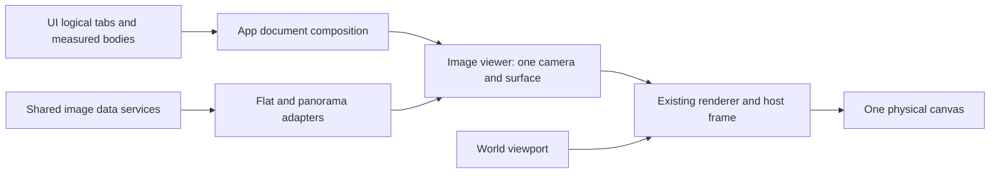

# Shared image viewer implementation specification

Status: proposed implementation contract. No viewer implementation or repository rename is performed by this document.

Date: 2026-10-13.

This specification follows the shared-viewer discussion and the subsequent package naming decisions. It is based on the current side-by-side checkouts, not an earlier viewer proposal. Cross-repository coordination belongs in this document; component API specifications and test evidence should accompany their implementing repositories.

## 1. Outcome and scope

Build a reusable FOSS Earth image viewer whose visible sources are selected by the existing left and right window tabs. One participating image tab displays one image. One participating image tab on each side displays a comparison through one camera and one shared surface, with a movable vertical wipe.

The first usable milestone must compare existing flat images closely enough to judge a half-resolution input, a stored WebGPU output, and a stored reference. Put the reference in one side and switch between input/output tabs in the other. The viewer must later compare panoramic images through the same surface and wipe.

The implementation must:

- Use the existing window/tab system, including dragging tabs between sides.
- Put the photograph in tab content, with a joined body when comparing.
- Keep wheel and trackpad pinch zoom anchored under the pointer, and support horizontal and vertical two-finger pan.
- Preserve WebGL 1, WebGL 2, and WebGPU coverage through the existing renderer infrastructure.
- Share photograph rendering, input handling, and panorama camera code with the live panorama viewer.
- Reuse the host canvas, device, scheduler, image broker, cache, and uploader.

The AI frame-generation/upscale research preview, harness, configuration, model runs, and generated results are outside scope. Do not edit or run them to implement or qualify the viewer. Test with viewer-owned synthetic fixtures and already-existing image files. Implementation starts at Stage A and continues in stage order. Passing the flat-viewer milestone establishes a prerequisite for later study work; it does not itself authorize resuming that work.

## 2. Verified starting points

Paths below are relative to `/Users/felg/gh/foss-earth`, using the pre-migration repository names.

| Current source | Relevant behavior or gap |
| --- | --- |
| `360/src/renderer.ts`, `shaders.ts`, `shadersWebGl.ts` | One full-screen immersion surface; two sources share a ray but crossfade. Source kinds are equirectangular, cube, and tiles. |
| `360/src/viewer.ts`, `ports.ts` | Viewer lifecycle assumes placed panorama images, orb preparation, and globe navigation. |
| `360/src/look.ts`, `browserInput.ts` | Existing look model and browser binder; zoom changes FOV without an anchor. Touch pinch does not account for midpoint translation. |
| `360/src/math.ts` | Shared view-ray math exists. The existing “flat window” is an orb appearance, not a flat photograph. |
| `360/src/panels.ts` | One active panorama's details/settings tabs, not independent image document tabs. |
| `ui/src/windowing/core/workspaceState.ts` | Existing open/select/close/move operations; a tab ID belongs to one side. |
| `ui/src/shell/WindowOverlay.tsx`, `compactWorkspace.ts` | Active-tab visibility and responsive folding exist. Folding currently changes presented slot membership. |
| `app/src/shell/WindowOverlay.tsx` | Additional-tab composition exists, but its ordinary wrapper appends preset controls and is unsuitable for a non-scrolling image surface. |
| `app/src/styles/base.css`, `engine/src/babylon/uiOcclusion.ts` | Split presentation physically places the canvas below the tab band; overlay panels mask world drawing. |
| `images/src/contracts.ts`, `records.ts` | Existing asset/role/sampling contracts assume panoramas in several places. Persisted source URLs are HTTP(S); local files require a resolver. |
| `renderer/src/babylon/imageUploadTypes.ts` | Existing uploader accepts arbitrary rectangular 2D images as well as cube faces. |

The interaction reference is [360-Side-By-Side at the audited revision](https://github.com/Felipegalind0/360-Side-By-Side/blob/a2792ce2833ae504375626481d09491b0777b310/components/panorama-viewer.tsx). Reuse its screen-space wipe behavior, without importing its Three.js renderer or its FOV-only camera behavior.

## 3. Repository ownership and migration

| Current repository/package | Target repository/package | Responsibility |
| --- | --- | --- |
| `360` / `@foss-earth/360` | `sphere-image` / `@foss-earth/sphere-image` | Documents, viewing sessions, surface composition, rectangle/sphere cameras, common input, viewer controls, optional globe integration |
| `equirectangular` | `sphere-equirectangular` / `@foss-earth/sphere-equirectangular` | Equirectangular representation records, validation, preparation, coordinate conventions, loading and sampling |
| `cubemap` | `sphere-cubemap` / `@foss-earth/sphere-cubemap` | Six-face representation records, geometry, preparation, loading and sampling |
| `tiled-cubemap` | `sphere-tiled-cubemap` / `@foss-earth/sphere-tiled-cubemap` | Tile layout, selection, streaming, residency and sampling |
| New | `rectangle-image` / `@foss-earth/rectangle-image` | Rectangle representation records, pixel dimensions, bounds/UV conventions, estimates and resource adapters |
| `images` | `images` | Common image data services, identity, decoding, color/orientation handling, cache and accounting |
| `ui` | `ui` | Canonical tab/window state, chrome, joined content layout, focus and geometry publication |
| `renderer` | `renderer` | Device/backend services, uploads, frame lifecycle, generic surface rectangles and pass support |
| `app` | `app` | Composition of the shell, document registry, viewer and renderer; image opening and source resolution |
| `engine` | `engine` | World viewport, globe navigation/picking and existing gesture classification |

Package and code names follow the mathematical object an image covers: a `sphere` (every direction from one point, stored as an equirectangular image, a cube or a tiled cube) or a `rectangle` (a plane photograph). The three sphere package names receive the `@foss-earth/` scope. The new rectangle package follows their representation-adapter pattern; it does not contain a separate viewer or gesture system. Saved values and persisted ids keep their existing spelling: the `panorama` entity type, the `panorama-image` asset type, `initialPanorama`, `scene.panorama.*` and `renderer.experiments.panorama*` settings, `panorama.*` gamepad actions and `standard-panorama-*` bindings, the `panorama` and `panorama-settings` tab ids, panel section ids, the `panorama-scenes` path and the scene schema's `$defs`. On-screen text still says "360 image" and "panorama".

Inside `image-viewer`, separate the reusable surface/session from globe entry/exit. Keep pure contracts/cameras importable without initializing a DOM, scene, device, network session or clock. Keep browser input, rendering, resources, UI contributions and globe adapters behind explicit entry points. Flat viewing must not require ECEF placement, a navigation lease, orb creation, a cube preview or scene membership.

`images` must not acquire camera models, gesture interpretation, tab state, comparison state, surface layout or feature drawing. Representation packages must not acquire shell or camera ownership.

### Migration rules

These checkouts are independent Git repositories, not one root workspace. Migrate package identities, public import paths, local-source dependency paths, install/pack scripts and current documentation deliberately. Preserve Git history and pre-existing uncommitted work.

1. Inventory actual consumers and public exports before changing names. Exclude research directories and retained historical evidence from transformations.
2. Establish one canonical implementation for each new name. Keep thin compatibility exports for existing package names/subpaths while untouched consumers require them. Preserve required local-source resolution through the existing composition tooling; do not duplicate implementation trees.
3. Update current consumers, including `app`, `scenes`, `preview-sheets`, and relevant `engine`/`ui` fixtures. Regenerate lockfiles through the established install process.
4. Qualify both renamed public exports and old compatibility exports using isolated consumer fixtures. Do not run the research harness as a compatibility test. Compatibility must cover the public and direct-path imports actually used by retained consumers; inventory these from existing manifests/receipts or supplied dependency records without editing their source.
5. UMN-VR has actual viewer/representation consumers and archived Earth package receipts. Adopt rebuilt artifacts and verified receipts through its existing workflow; never relabel old archives or hashes. No host-owned viewer is required. No necessary direct 0sfs runtime migration was found in the audit.
6. Hosted repository renames are separate repository-administration operations. Package metadata changes alone do not accomplish them. Record completion of local/package and hosted-name migration separately.

Package renaming must not change existing serialized panorama asset types, projection discriminants, scene schemas, asset revisions or media URLs. In particular, preserve existing `equirectangular`, `cube` and `tiled-cube` representation values. Do not globally substitute every occurrence of `360`, `cube` or `equirectangular`.

The existing Node panorama preparation CLI remains isolated behind compatibility entry points for this increment, including its command behavior. Relocating its orchestration into a future `panorama-preparation` owner is a separate cleanup. Keep Node tooling outside browser imports and do not regenerate assets during the viewer migration.

## 4. Core contracts and state authority

The following are contract shapes, not mandated filenames or finished TypeScript declarations:

```ts
type ImageDocument =
  | { id: string; assetId: string; revision: string; title: string;
      kind: "flat"; source: FlatSourceDescriptor }
  | { id: string; assetId: string; revision: string; title: string;
      kind: "panorama"; source: PanoramaSourceDescriptor;
      contentFromCommon: Mat3 };

interface ImageTab {
  tabId: string;       // Unique window-tab instance.
  documentId: string; // Multiple tabs may reference the same document.
}

interface SurfaceGeometry {
  revision: number;
  cssRect: Rect;
  framebufferRect: Rect;
  pixelsPerCssX: number;
  pixelsPerCssY: number;
  visible: boolean;
}

interface ImageSurfaceFrame {
  geometry: SurfaceGeometry;
  camera: FlatCameraSnapshot | PanoramaCameraSnapshot;
  left: SlotPresentation | null;
  right: SlotPresentation | null;
  wipe: number; // 0 = right only; 1 = left only.
}
```

`SlotPresentation` includes document identity/revision and a discriminated loading/ready/error state. A pending replacement is separate from the published source. A source handle is owned or explicitly retained; it is never an untracked raw texture.

Authority must remain unambiguous:

- UI owns logical side membership, selected tab and explicit collapse state.
- App resolves tab IDs to image documents and derives the requested single/pair session.
- Viewer owns camera, registration domain, wipe, source presentation and generation checks.
- Representation adapters own coordinate/sampling conventions and format-specific resource work.
- Renderer owns framebuffer/device state and presentation within the host frame.

Use a committed workspace snapshot containing both logical sides, context visibility, selection, focused side and collapse state. The existing `(tabId, visible)` notification cannot express this contract alone. Add an explicit slot-targeted action for opening a newly registered tab, alongside snapshot subscription. Selecting an already-open tab retains its existing side; duplication creates a new instance, and the existing move action changes its side. UI publishes committed geometry separately; the frame uses a consistent geometry revision for drawing and coordinate conversion.

Add flat data contracts without weakening panorama validation. Preserve the existing panorama asset type and cube-preview requirements for consumers that require them. Define a rectangle asset/representation path with `type: "rectangle-image"`, `projection: "rectangle"`, width, height, identity/revision and a source reference. The shared representation `role` union is currently `"preview" | "immersion"`; extend it with an image role for this primary representation. Panorama validators continue to require a cube preview. Shared record bases may be generalized while retaining compatible panorama aliases and validators. Flat density uses pixels in its image plane, never cube-face or angular-density units. Do not repurpose the existing direction-based `SourceSampler` for planar sampling.

## 5. Tabs, comparison and layout

A participating source is the selected image-document tab on a logically visible, expanded side. Logical visibility is determined by context policy and explicit collapse, never responsive folding. Inactive tabs, ordinary tabs, context-hidden tabs and explicitly collapsed sides do not contribute sources.

| Left participation | Right participation | Presentation |
| --- | --- | --- |
| None | None | No image surface |
| A | None | A alone, no wipe |
| None | B | B alone, no wipe |
| A | B, compatible | One camera, one joined surface, adjustable wipe |
| A | B, incompatible | Joined content explains incompatibility; both tab identities remain visible |

Compatibility initially means flat images with exactly matching aspect ratio and the user's intended common framing. Compare integer dimension cross-products: `widthA * heightB === widthB * heightA`, using overflow-safe arithmetic. Differing ratios, including rounding from odd-sized half-resolution inputs, require explicit registration and are deferred; do not silently stretch them. Later panorama pairs are compatible across the supported panoramic representations. Flat/panorama pairs and differently cropped flat pairs also require explicit registration. Report known incompatibility rather than silently fitting two unrelated views; matching aspect alone does not establish that photographs depict the same framing.

Opening, selecting, moving and closing use existing workspace actions. Image tabs have distinct instance IDs and no common mutually exclusive conflict group. Opening the same asset twice may create two tab instances sharing one document/resource. Source URL equality does not determine whether a comparison exists.

Moving a tab activates it at the destination. The vacated side follows its existing fallback selection. Recompute presentation from that result. Closing or collapsing a participant removes its visible demand. Selecting Settings or another ordinary tab on one side yields a single image on the other side, alongside the ordinary content.

### Content geometry

- A single image occupies its tab body. If the other window is empty and shell presentation is `split`, retain the shell's full-width single-window behavior.
- Two image bodies join into one contiguous rectangle beneath the existing two tab strips. Align their body tops/heights and include the space between columns. That gap is part of the photograph. While the join is active, the log uses its existing non-floating presentation: the Log tab, with the floating center log hidden, including at widths that would otherwise be the dual arrangement. Do not select the Log tab as part of that change. Place it on the side it last occupied as a tab, or on the left if it has none, and leave each side's selected image tab selected. The Log tab is ordinary content, so choosing it later follows the ordinary-tab rule and leaves one image. Hiding the floating log does not move image tabs or change their logical sides. When the join ends, restore the arrangement sizes alone would choose, including a floating log when that width still fits one, and keep the saved log width.
- Initialize the joined height to the usable viewport under the two tab strips once the log is a tab, capped so the group stays on screen. A non-scrolling image body has no content height to inherit from the previous chrome. Retain that height for the joined session; group resizing changes the group height. Preserve ordinary window size/layout preferences on entry and restore them on exit, without overwriting saved per-window dimensions.
- The tab-strip column boundary and image wipe are independent. Moving either must not cause each image to acquire its own fit/aspect.
- Add a generic non-scrolling surface content capability to UI. It bypasses ordinary body padding/scrolling and the app's automatic preset-save footer. Normal tabs retain their existing wrappers.
- Keep controls inside the participating tab content. The wipe handle belongs to the image body and is also a keyboard-operable slider labelled with both source titles. New opening/inspection controls belong to image tabs, not floating world panels.

### Responsive behavior and restoration

Maintain canonical logical left/right state independently from responsive presentation. Resizing is not a tab move. The current compact-folding implementation must not erase a participant or change its comparison side.

The first flat milestone qualifies every width at or above the shell's existing stacked breakpoint, the width at which both windows can exist. Below that breakpoint, display an explicit compact-comparison limitation and preserve both logical selections for restoration; do not silently publish a different pair. For full completion, while any image participates, retain both occupied logical tab strips as labelled compact rows. Two images place those rows above one shared body. An image plus ordinary content uses separate stacked strip/body groups. One occupied side has one body. Collapsed sides retain their reachable strip/launcher. Return to ordinary responsive folding only when no image participates. All tab actions remain reachable, and compact presentation never changes canonical side membership.

Persist ordinary layout through existing workspace persistence. Restore URL-backed image documents only from explicit document descriptors with resolvable source identities. Local files are session-owned; after reload, show a reselect-file state instead of retaining invalid blob URLs. Source bytes must not be embedded in workspace state.

### Camera continuity

Wipe movement and left/right swaps retain the same camera and registration domain. Pair-to-single retains the surviving image's current view. A compatible tab replacement retains the surface camera, enabling input/output switching against a reference. An incompatible projection/domain change restores that document's saved view or performs an explicit initial fit. It must not silently reinterpret the old camera.

## 6. Canvas and rendering composition

Use one host-owned physical canvas, renderer device and frame scheduler. When image tab surfaces are present, the physical canvas must cover the shell; the world and image surfaces receive independent rendering rectangles.



The image body needs an actual transparent, unfiltered opening through the panel, plus a DOM hit/focus element. Parent backdrop filters must not blur the photograph. Ordinary chrome remains opaque and world-occluding.

Draw the image pass into its own measured rectangle after world effects, bypassing world depth occlusion, atmosphere, lighting, tone mapping and world-only postprocessing. It supplies a defined background outside image coverage and in loading/error regions. Each pass establishes and restores viewport, scissor, depth, blending and clear state. The image pass must not inherit the world's reduced viewport or clear unrelated canvas regions.

Moving the canvas to shell size requires a world-viewport audit. Supply world dimensions to globe projection, ray picking, pointer normalization, mouse/wheel/touch pan, inertia, navigation camera, overlay projection and imagery detail selection. Replacing CSS alone is insufficient. Preserve the existing World size Release/Live behavior as world-surface behavior, with consistent geometry while a resize is held.

### Projection and wipe invariant

For every image-surface pixel:

1. Compute a coordinate using the entire shared viewport and one camera.
2. Map it to each source using that source's representation/registration.
3. Sample both sources with valid derivatives and consistent color handling.
4. Select left when surface-local normalized X is below `wipe`; otherwise select right.

`wipe` ranges from 0 through 1. Its position is independent of canvas origin, device pixel ratio, shell columns and projection. The divider must not change camera aspect, scale, translation or orientation. Sample through uniform control flow before the selection mask where derivatives require it. Single mode requires only one source and has no empty comparison half.

Continue the existing WGSL and GLSL paths, including relevant WebGL shader variants. Keep one rendering implementation across the live panorama and tab surface, factored into shared sampling/composition primitives. Do not add Three.js, a separate WebGPU device, a second scene render loop, or canvas readback as the presentation bridge.

Split capability checks by actual feature needs. The existing global panorama gate includes orb fragment-depth requirements; an unsupported orb-depth feature must not unnecessarily disable a flat surface. Preserve the existing supported panorama capability envelope and expose explicit unsupported-capability states.

### Comparison slots and refinement

Left/right sources are document slots. The live viewer's existing `source`/`next` crossfade represents replacement within one source lifecycle and must remain a separate concept.

For comparison, publish each complete replacement handle/representation atomically after readiness and generation checks. Retain the other side's published source. Tiled residency may progress incrementally: publish each display-table entry only after its atlas upload is ready, using existing preview/ancestor fallback. A tiled source does not wait for every tile before becoming usable. A steady tiled pair uses six samplers; independent per-side tiled crossfades can exceed WebGL 1's sampler budget. Do not add those crossfades in this increment. Preserve the existing single live-panorama transition/refinement behavior.

## 7. Cameras and image registration

### Flat camera

Define image-plane origin at top left, X right and Y down. A comparison has one canonical extent and a source-to-plane mapping per participant. Same-framing sources occupy the same extent regardless of native dimensions. A 960 by 540 input and 1920 by 1080 reference therefore align edge-for-edge.

Initialize the extent from the first displayed image, and retain it across compatible source changes and side swaps. Store scale and translation relative to that extent. Initial fit preserves aspect. Resizing retains scale and the plane point at viewport center; it does not independently refit sources. An explicit Fit command may reset the camera.

For local CSS position `p`, plane point `q`, translation `t` and scale `s`:

```text
p = t + s q
q_anchor = (p_anchor - t) / s
s_new = clamp(requestedScale)
t_new = p_anchor - s_new q_anchor
```

Clamp scale before calculating translation. Do not follow anchored zoom with edge recentering. Allow margins as needed to preserve the point under the pointer. Explicit Fit resets margins.

Two-finger swipe changes translation in both axes using the existing OS-normalized scroll convention. For touch pinch, preserve the plane point under the old midpoint at the new midpoint while applying separation change; scaling and midpoint translation are one update.

Provide Fit and native-pixel inspection in image-tab controls. Native-pixel scale names the focused source that defines it: one texel of that source maps to one framebuffer pixel. The focused source is the selected image tab on the last explicitly focused side, falling back to the survivor when that side stops participating. For source width `Wi`, canonical width `Wc`, and equal X/Y framebuffer pixels per CSS pixel `r`, the CSS scale is `Wi / (Wc * r)`. Check both measured pixel ratios; if they differ, adjust surface geometry to an isotropic mapping before qualifying native mode, or report the limitation. Switching tabs alone never invokes this command or changes scale.

Invoking native inspection also snaps the focused source's texel centers to framebuffer pixel centers. Subsequent free pan or zoom may leave that alignment; update the native-alignment status instead of claiming continued pixel-exact presentation. Reinvoking the command restores scale and alignment. Test this with a one-pixel checker/grid fixture. The other source shares the registration transform and may have a different native texel density.

The tab must disclose effective rendering resolution. Native display-pixel inspection is qualified only when framebuffer resolution matches display device resolution without CSS resampling. If existing renderer resolution settings prevent that, identify the limitation and use the existing Renderer controls to correct it; do not label a scaled presentation as native display pixels. Preserve original texture dimensions and allow magnification beyond 1:1.

### Panorama camera

Extend the existing heading/pitch/FOV look model and view-ray math. Use one common spherical frame for the pair; apply each source's `contentFromCommon` orientation exactly once. Geographic conversion remains in the globe adapter.

Anchored FOV zoom captures the common-space ray through the pointer, proposes a new FOV, and solves heading/pitch so that the captured ray projects through the same pointer coordinate. Choose the continuous solution nearest the previous orientation, including heading wrap. Respect existing FOV and pitch limits.

A no-roll heading/pitch camera cannot preserve every off-center ray for arbitrary zoom-out near the poles. If the requested step has no feasible solution, limit it to the last feasible anchored pose. Do not apply a final pitch clamp that silently moves the anchor, and do not introduce unwanted roll to conceal the limit.

Two-finger swipe changes the common look orientation in both axes through this same model. Both sources always use the resulting common ray. Viewer geometry, rather than whole-canvas dimensions, supplies camera aspect and input conversion. Live immersion uses the same improved model through its globe adapter.

## 8. One input path

Generalize the existing browser look binder to an image-camera target with pan, anchored zoom, held rates, cancellation and motion stepping. Keep the existing engine wheel/gesture classification and control-key policy. Flat and panorama targets interpret the same normalized gestures.

| Input | Required handling |
| --- | --- |
| Mouse wheel | Zoom at event pointer coordinates converted to surface-local CSS coordinates |
| Chromium-style trackpad pinch | Existing pinch classification, anchored at the event pointer |
| Safari pinch | Gesture coordinates when valid; otherwise last valid pointer, with center only when no pointer is available |
| Two-finger trackpad swipe | Pan on both axes, preserving gesture classification and OS momentum; no second synthetic glide |
| Touch pinch | Separation and midpoint translation together |
| Pointer drag | Common image navigation; retain capture until release/cancel |
| Keyboard/controller zoom | Defined center anchor, routed to the focused surface |
| Wipe handle | Adjust wipe only; consume drag and slider navigation keys |

Choose one gesture owner at gesture start and retain it through the gesture, including momentum and pointer movement over other elements. The image gesture must never also navigate the globe or zoom the browser page. Generalize unused-input forwarding to registered surfaces rather than forwarding every unused event to the world canvas.

There is one keyboard/controller focus owner. Do not attach competing global look handlers for each source, or for both a visible tab surface and live globe immersion. The generic viewer requires no globe navigation lease; retain lease-specific behavior in the globe input adapter. Controls keep keys they consume using the existing shared policy.

On blur, detach, explicit cancellation, document selection/removal/revision change or a projection-target replacement, clear pointer captures, held rates, active gesture anchors and inertia. Preserve the camera where section 5 requires continuity. Suppress remaining wheel momentum until the next fresh gesture using the existing gesture-session timing; do not deliver it to the globe or a newly selected source. Same-document quality refinement and a side swap retaining the same source set may preserve the gesture. Neither case attaches another input system.

## 9. Loading, fidelity and lifecycle

Expose `+ → Open image` in either existing window. It opens a normal tab containing File and URL controls, including when no image documents exist. Successful opening registers a document tab and selects it in that invoking logical side through the slot-targeted action. Support existing HTTP(S) images and local files through a session-owned resolver. Dimension discovery is a bounded, accounted image-data operation: the current `obtainInferred` infers MIME but still requires dimensions, so it is not a complete arbitrary-file opening API.

Use the existing broker for encoded bytes, decoded pixels, upload staging and GPU residency. Reserve before allocation, retain native inputs through asynchronous work, and release after actual completion. Local resolver ownership includes file/blob lifetime; do not loosen persistent URL validation to accept arbitrary `file:` or stale `blob:` records.

The first slice supports static opaque sRGB JPEG/PNG with identity or absent EXIF orientation. Unsupported orientation, transparency or color data must be identified, never silently stripped or misrepresented. Common normalization support may extend that contract later in `images`; representation modules must not duplicate codecs. Source titles, native dimensions, loaded resolution, sampling mode and limitations are inspectable inside image-tab content.

Upload native dimensions. If an image exceeds a device limit or admitted budget, show the reason; do not silently downsample it for comparison. Default to a documented linear sampling policy with a nearest-texel inspection option shared by both sources. Sampling is surface draw state: use per-draw samplers/bindings or safely restore WebGL 1 texture state so a cached texture's other consumers are unaffected. Honor WebGL 1 non-power-of-two restrictions. Preserve existing color conventions and test backend parity with tolerances: interpolated output is not assumed bit-identical across WebGL and WebGPU.

Changing the selected document clears that slot's old visual identity immediately. A loading/error region identifies the requested document instead of showing an old photograph under its new tab title. Refinement of the same document may retain its existing identified source until replacement is ready. Initial comparison may show one ready region and one loading region without moving the wipe or camera.

Use generation checks for tab changes, cancellation, source revision, context/device loss and disposal. A late result can never republish into a replaced slot. Two tab instances referencing one asset share cached resources through independent holds. Hidden documents release active rendering/streaming demand; reusable data follows the common cache policy. Device restoration reacquires valid source handles through the existing resource lifecycle.

Opening tab images must not enter panorama context or create Return-to-map controls. The existing live panorama lifecycle remains available through its adapter. If live immersion and image tabs coexist, app focus routes input to exactly one active navigation target; their camera states remain independent instances of the shared camera implementation.

## 10. Delivery sequence

Each step must leave the existing app and live panorama consumer buildable. Use the affected packages' required checks and isolated public-consumer checks; these steps do not include deployment or research execution.

Implement the stages in order. Stage A is finished before Stage B starts, and Stage B before Stage C. Build the new package identities and compatibility exports first. Do not implement the surface, camera, or wipe under the pre-migration names and rename afterward. The frame-generation/upscale study stays stopped until the Stage C flat gate passes.

| Stage | Deliverable and exit condition |
| --- | --- |
| A: ownership and compatibility | New package identities, compatible old imports, pure entry boundaries, new flat representation contracts; existing panorama tests/consumers pass. Hosted rename status recorded separately. |
| B: shell/surface foundation | Canonical logical tab state, non-scrolling/joined content at the usable height under the tab strips, Log tab instead of the floating log for the duration of a join, measured surface ports, full-shell canvas and correct world viewport consumers; world/shell regression checks pass. |
| C: first usable flat comparison | File/URL opening, native-resolution flat resources, one flat camera, wipe, shared input, inspection controls, stable compatible tab switching; flat acceptance gate below passes on all three backends at qualified desktop widths. |
| D: panorama pair and shared live behavior | Common ray with per-source orientation, equirectangular/cube/tiled sources in either slot, anchored panorama zoom, atomic comparison refinement; existing live panorama behavior and panorama acceptance pass. |
| E: full compact presentation and migration completion | Both logical tab strips usable in compact joined presentation; current consumers adopt canonical names/artifacts; compatibility retained only where required by deliberately untouched consumers. |

Stage C is the smallest usable study prerequisite. It includes the shell/viewport work needed for actual image tabs. General crop alignment, mixed flat/panorama comparison, HDR/wide-gamut viewing, alpha compositing, video/live GPU texture feeds and independent comparison-slot crossfades are later work.

## 11. Acceptance and evidence

Use deterministic viewer-owned fixtures: labelled grids, hard edges, sRGB ramps, half/full-resolution versions with identical framing, non-power-of-two images, and panorama cardinal/seam/pole patterns. Record browser, actual backend, device limits, DPR, render scale and fixture identities with visual evidence. Mock-device checks alone cannot qualify backend coverage.

### Flat milestone gate

1. One participating side shows one image without a divider; two compatible sides show one shared comparison. Moving/closing/minimizing/selecting tabs follows the table in section 5, including comparing two instances of the same asset.
2. Sweeping the wipe over identical sources introduces no displacement or moving seam. Endpoints show the whole corresponding source. Camera state is unchanged by wipe updates.
3. Half/full-resolution landmarks remain registered through zoom, two-axis pan, side swaps, compatible tab switches and surface resizing. Registration error must remain within 0.5 framebuffer pixel at tested landmarks.
4. Anchored flat zoom preserves the captured plane point within 0.25 CSS pixel in numerical/integration checks and within one framebuffer pixel in browser checks, including off-center anchors, clamped scale and DPR changes.
5. Trackpad pinch, Safari gestures, two-axis swipe, mouse drag and touch midpoint motion reach one target only. Slider and text controls retain their inputs. Blur/close/cancel leaves no stuck rates or capture.
6. Native-pixel inspection uses the named source, measured X/Y framebuffer ratios and texel-center alignment. A checker/grid confirms exact alignment; free motion updates its qualification. Texture dimensions remain original. Unsupported size/budget/color/orientation cases produce explicit states.
7. Actual WebGL 1, WebGL 2 and WebGPU runs pass geometry/wipe checks, including WebGL 1 non-power-of-two sources. Color fixture comparisons use documented tolerances and sampling modes.
8. Closing/moving/switching tabs during decode/upload cannot publish stale content or leak source holds. Same-asset tabs share allocation. Device loss/restoration does not retain invalid textures.
9. Overlay and split shell presentations, unequal starting panel heights, normal controls beside an image, resize Release/Live, and world zoom/picking/imagery detail remain correct. No whole-canvas dimension accidentally becomes a world-viewport dimension. While two images are joined, the floating log is hidden, the Log tab is present and not selected, and the center gap shows the photograph and wipe. Ending the join restores the size-chosen log presentation, including a floating log when the width still fits one.
10. At an unqualified compact width, show the declared limitation and restore the original pair on expansion without changing logical side membership. Full completion replaces this limitation with the compact rows in section 5. The Stage E record is in `shared-image-viewer-status.md`. Re-running the Stage C gate unchanged would still expect the limitation; do not write that rerun over `app/build/stage-c`.

### Panorama and full-completion gate

1. A panorama pair uses one camera and two source orientations. Equirectangular, cubemap and tiled-cubemap sources can be paired across representations and supported backends.
2. Anchored panorama zoom preserves the captured ray's projected position within the flat zoom's screen-space tolerances for feasible motion. Near poles, heading wrap and pitch/FOV limits, the camera stays continuous and stops at a feasible anchored pose.
3. The wipe remains a screen split while looking around; it does not become a longitude split or change either source's camera.
4. Seam, pole, orientation, color and tile-fallback fixtures pass. A tiled pair remains within actual sampler/device limits, swaps source handles atomically and publishes incremental tile residency only after its uploads are ready.
5. Existing globe orbs, terrain depth, picking, entry/exit flights, geographic orientation, navigation handover, live refinement and cancellation tests pass. Improved anchored input is exercised in live immersion as well as image tabs.
6. Compact layout retains both logical source sides and exposes their tab actions. Ordinary tabs keep existing behavior and persisted home sides.
7. Renamed packages and compatibility exports pass installed-consumer checks. UMN artifacts/receipts correspond to rebuilt packages. No research source, preview, configuration, model execution or generated result was changed by this work.

Completion evidence must distinguish Stage C readiness from full implementation completion. Do not claim the study viewer is qualified until the actual flat gate passes, and do not claim panoramic comparison support from flat tests alone.
