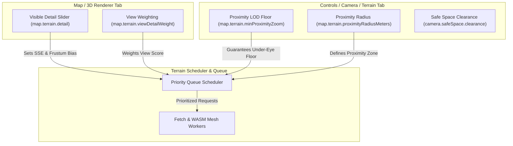

# Terrain LOD Priority & Proximity Decoupling Proposal

**Status**: Proximity/LOS implementation completed and optimized on 20 October 2026;
broader architecture ideas remain proposals. See the
[implementation and measurements](../validation/terrain-proximity-lod.md).
**Date**: October 2026  
**Context**: FOSS Earth Engine (`@foss-earth/engine`), 0SFS Flight Simulator, Android WebGPU / Mobile browsers  
**Related Documents**:
- [`camera-motion.md`](../camera-motion.md) (Safe space rules and camera physics)
- [`optimization-backlog.md`](../optimization-backlog.md) (Items R3, R5, R8, T4, T5, T14)
- [`webassembly.md`](webassembly.md) (WASM terrain core & collision BVH)
- [`engine/src/terrain/terrainSelector.ts`](file:///Users/felg/gh/foss-earth/engine/src/terrain/terrainSelector.ts)
- [`engine/src/babylon/createRasterTilesRuntime.ts`](file:///Users/felg/gh/foss-earth/engine/src/babylon/createRasterTilesRuntime.ts)
- [`engine/src/settings/catalogue/loading.ts`](file:///Users/felg/gh/foss-earth/engine/src/settings/catalogue/loading.ts)

---

## 1. Executive Summary

During testing on Android Chrome with WebGPU on smartphones, two interrelated anomalies were observed:
1. **Low-LOD Tile Retention & Asymmetric Resolution**: Low-detail terrain tiles lingered on screen unexpectedly long, creating stark boundaries between high-resolution terrain and low-resolution blurry patches ("a wall of high-res on one side and zero detail on the other").
2. **Safe-Space Camera Altitude Jolts**: Rapid camera orbiting and heading changes, particularly when looking toward the horizon, caused the camera to abruptly jolt upward.

Investigation revealed four underlying race conditions and architectural limitations in tile selection, LRU caching, and quadtree display synchronization. A non-breaking, opt-in mitigation was implemented under `map.terrain.robustOrbitLOD`.

This document records the complete root-cause findings, the opt-in mitigation, and the architectural plan for a **Weighted Priority Terrain LOD System** that decouples view-direction detail from under-eye/proximity detail, establishes independent minimum acceptable detail floors, and separates the UI controls across dedicated tabs.

---

## 2. Root Cause Analysis

### 2.1 Coarse Stand-In Elevation Race Condition
- **Mechanism**: When high-resolution (HD) elevation tiles are requested, lower-zoom coarse stand-ins (e.g. $z=4$) are often fetched concurrently to provide quick geometric placeholders.
- **Flaw**: In [`createRasterTilesRuntime.ts`](file:///Users/felg/gh/foss-earth/engine/src/babylon/createRasterTilesRuntime.ts), when a coarse stand-in arrived after or concurrently with an HD elevation response, `record.targetTerrainZoom` was updated directly without comparing against the higher zoom already being processed. Because `record.mesh.metadata.terrainZoom` remained $0$ until the mesh update committed on the main thread, the late-arriving coarse stand-in overwrote `record.targetTerrainZoom`.
- **Result**: The tile mesh was committed with coarse $z=4$ elevation, wiping out the fine terrain elevation even though HD data had already been downloaded.

### 2.2 Rapid Orbit LRU Eviction
- **Mechanism**: When orbiting or changing heading rapidly (e.g. spinning $360^\circ$), the camera frustum pans across all compass quadrants in quick succession.
- **Flaw**: Tile retention in `evictIfNeeded` was bounded strictly by `cachedTiles` (~160 tiles). When completing a rapid turn, tiles that had just been in view were evicted as the opposite horizon loaded, causing the camera to look back at empty or low-LOD stand-ins that required full re-download.

### 2.3 Frustum-Edge Quadtree Display Blocking
- **Mechanism**: Quadtree refinement divides parent tiles into four children.
- **Flaw**: In `buildDisplayKeys`, child leaves within the visible frustum that had settled their HD elevation were prevented from displaying if sibling leaves in the same quadtree branch (which happened to fall outside the camera frustum) were still queued or fetching.
- **Result**: Visual detail in the frustum was held hostage by off-screen tiles, creating stark geometric steps and delays along frustum edges.

### 2.4 Safe-Space Ground Clearance Jolts
- **Mechanism**: [`camera-motion.md`](../camera-motion.md#the-rules) enforces rule 1 ("It never jumps") and specifies that `camera.safeSpace` maintains a $15\text{ m}$ clearance sphere around the camera (`camera.safeSpace.clearance = 15`) with a maximum upward acceleration of $60\text{ m/s}^2$ (`camera.safeSpace.acceleration = 60`).
- **Flaw**: When the user pitches up toward the horizon or looks into the distance, standard screen-space error (SSE) quadtree selection culls or demotes the tile directly underneath the camera eye to coarse ancestor levels ($z \le 10$).
- **Result**: Because coarse terrain mesh has lower geometric accuracy and vertical peaks can be tens of meters higher than fine terrain, the coarse mesh penetrates the $15\text{ m}$ safe-space sphere. The safe-space logic detects a ground penetration and jolts the camera vertically upward at $60\text{ m/s}^2$.

---

## 3. Opt-In Baseline Fix (`map.terrain.robustOrbitLOD`)

To avoid regressions to existing desktop and flight baselines, an opt-in setting was added to [`src/settings/catalogue/loading.ts`](file:///Users/felg/gh/foss-earth/engine/src/settings/catalogue/loading.ts):

- **Setting Key**: `map.terrain.robustOrbitLOD`
- **Default**: `false`
- **A/B Testing Query Param**:
  ```text
  https://localhost:5173/app/?set.map.terrain.robustOrbitLOD=true
  ```

### Key Changes When Enabled
1. **Stand-in Overwrite Protection**:
   In [`createRasterTilesRuntime.ts`](file:///Users/felg/gh/foss-earth/engine/src/babylon/createRasterTilesRuntime.ts), `record.targetTerrainZoom` is guarded by:
   ```ts
   const currentZoom = Math.max(record.mesh.metadata?.terrainZoom ?? 0, record.targetTerrainZoom ?? 0);
   if (terrainZoom < currentZoom) {
     return; // Never overwrite higher zoom with coarser stand-in
   }
   ```
2. **Expanded Orbit Cache Retention**:
   In `evictIfNeeded`, cache retention capacity scales to `Math.max(baseMax, maxTiles * 2)` when orbiting is detected, preventing reciprocal tile thrashing during $360^\circ$ turns.
3. **Decoupled Frustum Display**:
   In `buildDisplayKeys`, in-frustum children whose elevation has settled are permitted to display without waiting for out-of-frustum siblings.
4. **Under-Eye Tile Retention**:
   In [`terrainSelector.ts`](file:///Users/felg/gh/foss-earth/engine/src/terrain/terrainSelector.ts), `tileContainsMercator(tile, eyeMercator)` is checked. The tile containing the camera eye is pinned to a minimum safe LOD ($z \ge 13$) regardless of camera pitch angle, preventing coarse mesh penetration into `camera.safeSpace`.

---

## 4. Proposed Architecture: Weighted Priority LOD System (TODO)

While the opt-in fix addresses immediate race conditions, a comprehensive long-term solution requires separating **look-at visual detail** from **proximity geometric detail**.

### 4.1 Problem Definition
The camera has two fundamentally different LOD requirements with conflicting constraints:

| Requirement | Purpose | Critical Metric | Error Tolerance |
| :--- | :--- | :--- | :--- |
| **View Frustum (Look-At)** | Visual fidelity of what the user is looking at | Screen-space error (SSE), distance along gaze vector | High at periphery, low at focal center |
| **Proximity (Under-Eye)** | Safe space, collision avoidance, ground contact | Euclidean distance to eye/aircraft, vertical clearance | Zero tolerance for coarse height discrepancies |

Today, a single detail slider and single error threshold control both. When a user lowers detail to improve frame rate or pitches up to view the horizon, proximity detail drops alongside visible detail, leading to safe-space jolts and collision inaccuracies.

### 4.2 Decoupled Dual-Metric Scoring

Instead of a single scalar priority $P = \frac{\text{error}}{\text{distance}}$, each candidate tile should compute two independent scores:

$$\begin{aligned}
W_{\text{view}} &= \text{SSE}_{\text{screen}} \cdot \cos^\alpha(\theta_{\text{gaze}}) \cdot \frac{1}{1 + d_{\text{focus}}} \\
W_{\text{prox}} &= \max\left(0, 1 - \frac{d_{\text{horizontal}}}{R_{\text{prox}}}\right) \cdot \max\left(0, 1 - \frac{d_{\text{vertical}}}{H_{\text{prox}}}\right)
\end{aligned}$$

Where:
- $\theta_{\text{gaze}}$ is the angle between the tile center and the camera look vector.
- $d_{\text{focus}}$ is distance from the camera focal plane.
- $R_{\text{prox}}$ is the horizontal proximity radius (e.g. $500\text{ m}$ to $2\text{ km}$).
- $H_{\text{prox}}$ is the vertical proximity buffer (e.g. $100\text{ m}$).

The combined tile loading priority is:
$$P_{\text{load}} = w_{\text{view}} \cdot W_{\text{view}} + w_{\text{prox}} \cdot W_{\text{prox}}$$

### 4.3 Independent Minimum Acceptable Floors

To ensure stability across devices:
1. **`minVisibleLOD`**: Minimum acceptable resolution within the central view cone (e.g. $z=12$). Tiles below this level in the view cone are fetched before background periphery.
2. **`minProximityLOD`**: Strict minimum geometric resolution within $R_{\text{prox}}$ of the camera eye (e.g. $z=14$).
   - The tile directly containing the camera eye **never** unloads below this floor while the camera is within $H_{\text{prox}}$ of the terrain surface.
   - Prevents safe-space sphere penetration and camera jolting regardless of pitch, yaw, or view distance.

### 4.4 UI & Settings Decoupling

The UI controls should be partitioned to reflect this separation:



1. **Map / 3D Renderer Tab**:
   - The **Detail** slider exclusively adjusts screen-space error threshold ($\text{SSE}$) and visible visual geometry.
   - Adjusting this slider will **not** degrade terrain geometry directly beneath the aircraft or camera eye.
2. **Controls / Camera / Physics Tab**:
   - A dedicated **Terrain Proximity & Safe Space** section allows configuring:
     - Minimum proximity zoom floor (`minProximityZoom`, default $14$).
     - Proximity radius in meters (`proximityRadiusMeters`, default $1000\text{ m}$).
     - Safe space clearance and acceleration limits.

### 4.5 Integration with Lazy Loading and WebAssembly Workers

As background tasks introduce WASM mesh generators and worker queues:
- **Dedicated Priority Channels**: Elevation decode workers and collision BVH builders should use prioritized message channels. Proximity tiles required for ground clearance take precedence over distant visual horizon tiles.
- **Worker Allocation**: Ensure mobile WebGPU devices (which often have fewer worker threads) do not starve under-eye elevation processing during rapid camera panning.

---

## 5. Verification & Test Strategy

Any implementation of the weighted priority system should verify the following test scenarios:

1. **Horizon Pitch Test**: Pitch camera to $+10^\circ$ (looking slightly above horizon). Verify under-eye tile stays at or above `minProximityZoom` and safe-space altitude does not change.
2. **$360^\circ$ Continuous Yaw Spin**: Orbit camera $360^\circ$ at $90^\circ/\text{s}$. Verify tiles on initial heading remain in cache and do not revert to low-LOD stand-ins upon completing rotation.
3. **Asymmetric Frustum Boundary Test**: Position camera so child tiles straddle frustum boundary. Verify in-frustum children display immediately without waiting for out-of-frustum siblings.
4. **Detail Slider Isolation**: Slide 3D Renderer Detail slider from Maximum to Minimum. Verify under-eye elevation vertices and collision query heights remain unchanged.

